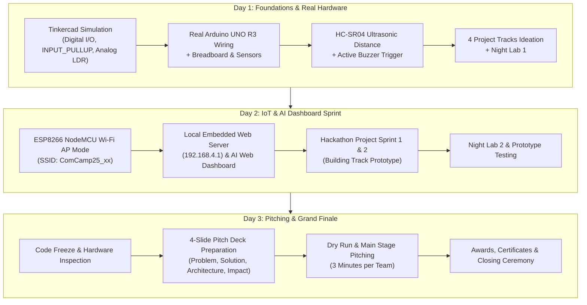
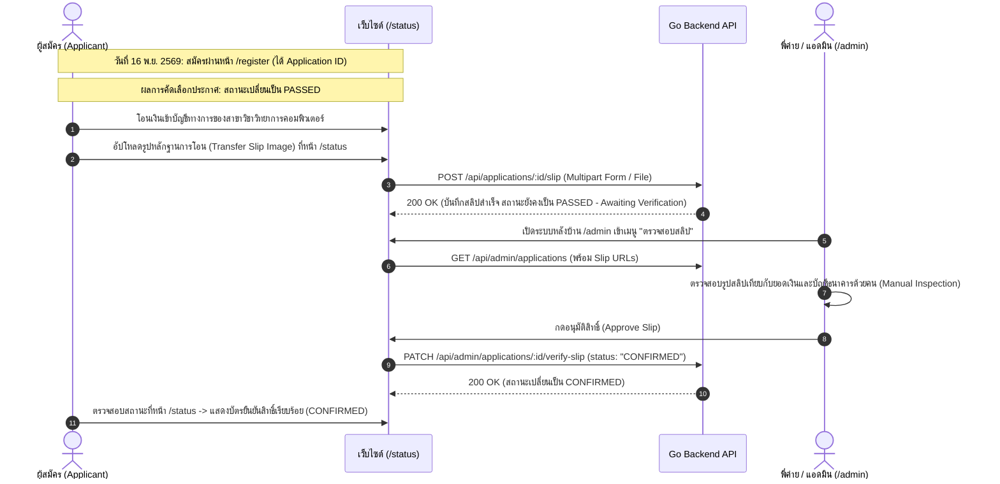

# ComCamp #25 — Project Handoff Documentation & Technical Specification
## เอกสารส่งมอบโครงการและข้อกำหนดทางเทคนิค ค่ายยุวชนคอมพิวเตอร์ ครั้งที่ 25

> **Repository:** [https://github.com/numcayX2/Comcamp-25th.git](https://github.com/numcayX2/Comcamp-25th.git)  
> **Host Organization:** สาขาวิชาวิทยาการคอมพิวเตอร์ คณะวิทยาศาสตร์ มหาวิทยาลัยแม่โจ้ (Computer Science Department, Faculty of Science, Maejo University)  
> **Last Updated (อัปเดตล่าสุด):** 4 พฤศจิกายน 2569 (2026-11-04)  
> **Target Audience:** Frontend Engineers, Go Backend Engineers, Design/Marketing Teams, Camp Organizers (พี่ค่าย)

---

## 1. Project Overview (ภาพรวมโครงการ)

**ComCamp #25 (ค่ายยุวชนคอมพิวเตอร์ ครั้งที่ 25)** เป็นค่ายวิชาการเชิงปฏิบัติการ (Hands-on Workshop & Hackathon) ระยะเวลา **3 วัน 2 คืน** จัดโดยสาขาวิชาวิทยาการคอมพิวเตอร์ มหาวิทยาลัยแม่โจ้ เพื่อเปิดโอกาสให้นักเรียนระดับมัธยมศึกษาตอนปลายและอาชีวศึกษาได้เรียนรู้การเขียนโปรแกรม การต่อวงจรฮาร์ดแวร์ IoT (Internet of Things) และการเชื่อมต่อระบบปัญญาประดิษฐ์ (AI) สู่เว็บบอร์ด โดยมุ่งเน้นการลงมือปฏิบัติจริงและการทำงานร่วมกันเป็นทีมโดยไม่จำเป็นต้องมีพื้นฐานมาก่อน

This repository is a monorepo housing both the modern static/SSR web frontend and the reserved Go backend service, designed for high reliability, fast loading, responsive UX across devices, and clock-tamper-proof countdown mechanisms.

---

## 2. Confirmed Camp Specifications & Tentative Items (ข้อกำหนดค่ายที่ยืนยันแล้ว และข้อมูลที่รอการยืนยัน)

*สถานะข้อมูลอ้างอิง ณ วันที่ 4 พฤศจิกายน 2569 (Status as of 2026-11-04)*

| Parameter (หัวข้อ) | Confirmed Value (ข้อมูลที่ยืนยันแล้ว) | Status / Notes (สถานะ / หมายเหตุ) |
|---|---|---|
| **Application Open Date (วันเปิดรับสมัคร)** | **16 พฤศจิกายน 2569 เวลา 00:00:00 น.** (`2026-11-16T00:00:00+07:00`) | ✅ **Confirmed** (ซิงค์ตรงกับระบบ Countdown) |
| **Seat Quota (จำนวนที่เปิดรับ)** | **30 คน** (30 seats) | ✅ **Confirmed** |
| **Eligibility (คุณสมบัติผู้สมัคร)** | **ม.4 – ม.6** และ **ปวช.1 – ปวช.3** | ✅ **Confirmed** (อ้างอิงเงื่อนไขและข้อมูลฟอร์มรับสมัครปีก่อน ไม่จำกัดสายการเรียน ไม่จำเป็นต้องมีพื้นฐานมาก่อน) |
| **Camp Duration (ระยะเวลา)** | **3 วัน 2 คืน** (3 Days 2 Nights) | ✅ **Confirmed** |
| **Registration Fee (ค่าใช้จ่าย)** | `TBD` (รอประกาศอย่างเป็นทางการ) | ⏳ **Pending Official Confirmation** (จะแจ้งเลขบัญชีและยอดโอนเร็วๆ นี้) |
| **Contact Channels (ช่องทางติดต่อ)** | `TBD` (รอประกาศเบอร์โทรและช่องทางโซเชียลทางการ) | ⏳ **Pending Official Confirmation** |

### 2.1 Curriculum & Schedule (หลักสูตรและการเรียนรู้ 3 วัน 2 คืน)

*(หมายเหตุ: ตารางการเรียนการสอนและรายละเอียดกิจกรรมอาจมีการปรับเปลี่ยนตามความเหมาะสมโดยคณะผู้สอน / Details subject to instructor adjustments)*



- **Day 1: ฮาร์ดแวร์พื้นฐานและการจำลองวงจร**
  - จำลองวงจรผ่าน **Autodesk Tinkercad Circuits** (`Digital I/O`, ตัวต้านทานภายใน `INPUT_PULLUP`, การอ่านค่าเซนเซอร์แสง `Analog LDR`)
  - ประกอบและต่อวงจรจริงกับบอร์ด **Arduino UNO R3**
  - เชื่อมต่อเซนเซอร์วัดระยะทางคลื่นอัลตราโซนิก **HC-SR04** และส่งเสียงเตือนด้วย **Active Buzzer**
  - แบ่งกลุ่ม เลือกหัวข้อโปรเจกต์ 4 Tracks และปฏิบัติการแล็บกลางคืน (Night Lab 1)
- **Day 2: โลกของ IoT และ AI Dashboard**
  - แนะนำบอร์ดไมโครคอนโทรลเลอร์ **ESP8266 NodeMCU** พร้อมตั้งค่า Wi-Fi Access Point (AP Mode)
  - พัฒนาเว็บเซิร์ฟเวอร์บนตัวอุปกรณ์ (Local Web Server ณ `192.168.4.1`) และเชื่อมโยงหน้าจอแสดงผล AI Web Dashboard
  - ช่วงเร่งพัฒนาโครงงาน (Project Sprint 1 & 2) และแล็บกลางคืน (Night Lab 2)
- **Day 3: เวทีนำเสนอและพิธีปิด**
  - **Code Freeze**: ยุติการเขียนโปรแกรมและการต่ออุปกรณ์ เพื่อเข้าสู่ขั้นตอนทดสอบเสถียรภาพ
  - สรุปผลงานด้วย **4-Slide Pitch Deck** (Problem, Solution/Hardware, Tech Architecture, Future Scope)
  - ซักซ้อม (Dry Run) และนำเสนอผลงานจริงบนเวทีใหญ่ (Main Stage Pitching ทีมละ 3 นาที)
  - มอบรางวัลโครงงานยอดเยี่ยมและเกียรติบัตรแก่ผู้เข้าร่วมค่ายทุกคน

### 2.2 The 4 Project Tracks (4 หัวข้อโครงงานหลัก)
1. **Track A — Smart Home Security**: ระบบเตือนภัยและรักษาความปลอดภัยในบ้านอัจฉริยะ (ตรวจจับความเคลื่อนไหว, วัดระยะบานประตู, แจ้งเตือนผ่าน Buzzer และ Web Interface)
2. **Track B — Smart Agriculture**: ระบบสมาร์ตฟาร์ม/แปลงเกษตรแม่นยำ (ตรวจวัดแสงแดด ความชื้น และสั่งงานรดน้ำอัตโนมัติ)
3. **Track C — Touchless Hygiene & Smart Counter**: ระบบสุขอนามัยไร้สัมผัสและนับจำนวนคนอัจฉริยะ (จ่ายเจล/เปิดประตูอัตโนมัติ พร้อมตรวจนับความหนาแน่นของผู้ใช้งาน)
4. **Track D — Smart Flood Early Warning**: ระบบตรวจวัดระดับน้ำและแจ้งเตือนภัยน้ำท่วมล่วงหน้า (ตรวจวัดระดับน้ำหลากแบบเรียลไทม์พร้อมส่งสัญญาณเตือนภัยฉุกเฉิน)

### 2.3 Payment & Confirmation Flow (ระบบชำระเงินและยืนยันสิทธิ์)

เพื่อความถูกต้อง ปลอดภัย และโปร่งใสที่สุด ComCamp #25 ใช้กระบวนการตรวจสอบสลิปแบบผสมผสาน (Hybrid Flow with Manual Slip Verification):



---

## 3. Monorepo Architecture & Route Status (สถาปัตยกรรมและสถานะหน้าเว็บ)

```
Comcamp-site/
├── .env.example              # ตัวอย่าง Environment Variables สำหรับ Go backend และ DB
├── .gitignore                # จัดการ ignore node_modules, dist, .env, scratch/ ฯลฯ
├── docker-compose.yml        # PostgreSQL 16 Alpine container (127.0.0.1:5432)
├── HANDOFF.md                # เอกสารฉบับนี้ (Master Technical & Camp Spec Handoff)
├── backend/                  # โฟลเดอร์สำหรับทีม Go Backend
│   └── README.md             # สรุปภาพรวมและคำแนะนำสำหรับทีม Backend
└── frontend/                 # เว็บแอปพลิเคชัน (Astro + React + Tailwind + Three.js)
    ├── package.json          # Astro 5, React 19, Tailwind CSS, Three.js, Lucide
    ├── astro.config.mjs
    ├── src/
    │   ├── layouts/
    │   │   └── BaseLayout.astro      # Master layout (Meta tags, fonts, styles)
    │   ├── pages/
    │   │   ├── index.astro           # เส้นทาง / (Split-Flap Countdown Landing)
    │   │   ├── home.astro            # เส้นทาง /home (Interactive 3D Hardware Stage)
    │   │   ├── register.astro        # เส้นทาง /register (Registration Form Skeleton)
    │   │   ├── status.astro          # เส้นทาง /status (Application Status & Confirm)
    │   │   └── admin.astro           # เส้นทาง /admin (Admin Dashboard)
    │   ├── components/
    │   │   ├── CountdownHero.tsx     # หน้าแรกนับถอยหลัง 100dvh Mechanical Split-Flap
    │   │   ├── SplitFlapDigit.tsx    # แอนิเมชันป้ายพลิก Mechanical Split-Flap 3D
    │   │   ├── FuturisticGradient.tsx# แบ็กกราวด์ Ambient WebGL/CSS Gradient
    │   │   ├── MainLandingPage.tsx   # คอมโพเนนต์หน้า /home (REV.25 Manual)
    │   │   ├── Rev25Stage3D.tsx      # เวที 3D หมุนบอร์ด Uno R3 & ESP8266 ด้วย Three.js
    │   │   ├── RegisterSection.tsx   # ฟอร์มรับสมัครพร้อม Client Validation
    │   │   ├── StatusSection.tsx     # ฟอร์มตรวจสอบสถานะและยืนยันสิทธิ์
    │   │   ├── AdminSection.tsx      # แดชบอร์ดแอดมิน จัดการสถานะผู้สมัคร
    │   │   └── ThemeToggle.tsx       # สลับโหมดสี (Dark/Light)
    │   └── lib/
    │       └── api.ts                # Shared API client + Fallback + Server Time Sync
```

### 3.1 Route Status Overview (สถานะปัจจุบันของแต่ละเส้นทาง)

| Route | Main Files | Description | Current Status |
|---|---|---|---|
| **`/`** | `src/pages/index.astro`<br/>`CountdownHero.tsx`<br/>`SplitFlapDigit.tsx` | **Mechanical Split-Flap Countdown Hero**<br/>นับถอยหลังสู่ 16 พ.ย. 2569 เวลา 00:00:00 น. มีระบบ Server Time Synchronization เพื่อป้องกันการแก้เวลาเครื่อง และแอนิเมชันป้ายพลิกสไตล์สถานีรถไฟอนาคต | 🟢 **Production-Ready** (มี Fallback อัตโนมัติเมื่อ Backend ปิดอยู่) |
| **`/home`** | `src/pages/home.astro`<br/>`MainLandingPage.tsx`<br/>`Rev25Stage3D.tsx` | **Main Landing Page ("REV.25 · The Reference Manual")**<br/>หน้าประชาสัมพันธ์ค่ายหลัก พร้อมเวที 3D Three.js หมุนชิป Arduino UNO R3 และ ESP8266 NodeMCU | 🟡 **Awaiting Redesign** (พร้อมใช้งาน แต่รอ Layout ร่างใหม่จากทีมออกแบบ/ผู้ใช้) |
| **`/register`** | `src/pages/register.astro`<br/>`RegisterSection.tsx` | **Registration Form Skeleton**<br/>แบบฟอร์มกรอกข้อมูลผู้สมัคร (ชื่อ, บัตร ปชช., เบอร์, โรงเรียน, ระดับชั้น ม.4-6/ปวช.1-3, ไซส์เสื้อ, เหตุผลที่อยากเข้าค่าย) เชื่อมโยงกับ `POST /api/applications` | 🟢 **Skeleton Ready** (เชื่อมต่อ Backend จริง พร้อม Fallback จำลอง) |
| **`/status`** | `src/pages/status.astro`<br/>`StatusSection.tsx` | **Application Status & Confirmation Skeleton**<br/>ค้นหาใบสมัครด้วยเลขบัตรประชาชน/เบอร์โทร/รหัสใบสมัคร, กดยืนยัน/สละสิทธิ์ และเตรียมรับการอัปโหลดสลิป | 🟢 **Skeleton Ready** (พร้อมเชื่อมต่อ API สลิปตามสเปก) |
| **`/admin`** | `src/pages/admin.astro`<br/>`AdminSection.tsx` | **Admin Dashboard Skeleton**<br/>หน้าสำหรับพี่ค่าย เข้าสู่ระบบด้วย JWT, ดูตารางผู้สมัครทั้งหมด, กรองสถานะ, อัปเดตสถานะใบสมัครเป็นรายบุคคล | 🟢 **Skeleton Ready** (พร้อมขยายเป็นระบบ Manual Slip Verification) |

---

## 4. Frontend <-> Go Backend API Contract (ข้อกำหนดการเชื่อมต่อ API)

Frontend สื่อสารกับ Go Backend ผ่าน HTTP JSON REST API โดยกำหนดค่าผ่าน Environment Variable `PUBLIC_API_URL` (ค่าเริ่มต้น: `http://localhost:8000/api`)

### 4.1 Data Models & Types

```typescript
// สถานะใบสมัคร 5 สถานะหลัก
export type ApplicationStatus = 
  | 'PENDING'    // รอดำเนินการคัดเลือก
  | 'PASSED'     // ผ่านการคัดเลือก (รอโอนเงินและอัปโหลดสลิป)
  | 'RESERVE'    // ตัวสำรอง
  | 'CONFIRMED'  // ยืนยันสิทธิ์และตรวจสอบสลิปเรียบร้อยแล้ว
  | 'REJECTED';  // ไม่ผ่านการคัดเลือก / สละสิทธิ์

export interface Application {
  id: string;                    // รหัสใบสมัคร เช่น "CC25-9A4B2C"
  fullName: string;              // ชื่อ-นามสกุล
  nickname: string;              // ชื่อเล่น
  nationalId: string;            // เลขประจำตัวประชาชน 13 หลัก
  phone: string;                 // หมายเลขโทรศัพท์
  email: string;                 // อีเมล
  school: string;                // โรงเรียน / สถาบันการศึกษา
  grade: string;                 // "ม.4" | "ม.5" | "ม.6" | "ปวช.1" | "ปวช.2" | "ปวช.3"
  shirtSize: string;             // "XS" | "S" | "M" | "L" | "XL" | "2XL" | "3XL"
  motivation: string;            // เหตุผลหรือความคาดหวังในการเข้าร่วมค่าย
  status: ApplicationStatus;     // สถานะปัจจุบัน
  attendanceConfirmed: boolean;  // การกดยืนยันการเข้าร่วม
  slipUrl?: string;              // URL รูปภาพสลิปโอนเงิน (ถ้ามี)
  slipUploadedAt?: string;       // เวลาที่อัปโหลดสลิป
  slipVerifiedBy?: string;       // ผู้ดูแลระบบที่อนุมัติสลิป
  createdAt: string;             // เวลาที่สร้างใบสมัคร (ISO 8601)
  updatedAt?: string;            // เวลาที่อัปเดตล่าสุด (ISO 8601)
}
```

### 4.2 API Endpoints Specification

#### 1. Public Health Check
- **Endpoint:** `GET /api/health`
- **Auth:** None
- **Response 200 OK:**
  ```json
  {
    "status": "healthy",
    "service": "comcamp25-backend",
    "time": "2026-11-04T12:00:00Z"
  }
  ```

#### 2. Public Camp Settings & Time Sync (ป้องกัน Clock Tampering)
- **Endpoint:** `GET /api/settings/public`
- **Auth:** None
- **Response 200 OK:**
  ```json
  {
    "serverTime": "2026-11-04T05:00:00Z",
    "registrationOpenAt": "2026-11-16T00:00:00+07:00",
    "isOpen": false,
    "currentCount": 0,
    "maxCapacity": 30,
    "campFee": null,
    "isCertificateReleased": false
  }
  ```

#### 3. Submit New Application (ยื่นใบสมัคร)
- **Endpoint:** `POST /api/applications`
- **Auth:** None
- **Request Body (JSON):**
  ```json
  {
    "fullName": "สมชาย ใจดี",
    "nickname": "ชาย",
    "nationalId": "1509900000000",
    "phone": "0812345678",
    "email": "somchai@example.com",
    "school": "โรงเรียนแม่โจ้วิทยาคม",
    "grade": "ม.5",
    "shirtSize": "L",
    "motivation": "อยากเรียนรู้การเขียนโปรแกรม IoT และต่อวงจรฮาร์ดแวร์จริง"
  }
  ```
- **Response 201 Created:** Returns created `Application` object with generated `id` (e.g. `CC25-XXXXXX`) and `status: "PENDING"`.

#### 4. Query Application Status (ตรวจสอบสถานะใบสมัคร)
- **Endpoint:** `GET /api/applications/status?q={query}`
- **Auth:** None
- **Parameters:** `q` ค้นหาได้ด้วย National ID (13 หลัก), Phone Number, หรือ Application ID
- **Response 200 OK:** Returns matching `Application` object.
- **Response 404 Not Found:** `{"error": "Application not found"}`

#### 5. Confirm or Decline Attendance (ยืนยัน/สละสิทธิ์เบื้องต้น)
- **Endpoint:** `POST /api/applications/:id/confirm`
- **Auth:** None
- **Request Body (JSON):**
  ```json
  {
    "confirmed": true
  }
  ```
- **Response 200 OK:** Returns updated `Application` object.

#### 6. Upload Payment Slip (อัปโหลดรูปสลิปโอนเงิน)
- **Endpoint:** `POST /api/applications/:id/slip`
- **Auth:** None (หรือส่งผ่าน National ID / Token verification)
- **Content-Type:** `multipart/form-data`
  - Field: `slip` (File: PNG, JPG, WebP สูงสุด 5MB)
- **Response 200 OK:**
  ```json
  {
    "id": "CC25-XXXXXX",
    "slipUrl": "/uploads/slips/CC25-XXXXXX-20261116.jpg",
    "status": "PASSED",
    "message": "อัปโหลดสลิปสำเร็จ รอดำเนินการตรวจสอบโดยเจ้าหน้าที่"
  }
  ```

#### 7. Admin Login (เข้าสู่ระบบผู้ดูแล)
- **Endpoint:** `POST /api/auth/login`
- **Auth:** None
- **Request Body (JSON):**
  ```json
  {
    "username": "admin",
    "password": "strong_password"
  }
  ```
- **Response 200 OK:**
  ```json
  {
    "token": "eyJhbGciOiJIUzI1NiIsInR5cCI6IkpXVCJ9..."
  }
  ```

#### 8. Admin List Applications (ดูรายชื่อผู้สมัครทั้งหมด)
- **Endpoint:** `GET /api/admin/applications`
- **Auth:** `Bearer <token>`
- **Response 200 OK:** Returns array of `Application[]`.

#### 9. Admin Update Status (ปรับเปลี่ยนสถานะใบสมัคร)
- **Endpoint:** `PATCH /api/admin/applications/:id`
- **Auth:** `Bearer <token>`
- **Request Body (JSON):**
  ```json
  {
    "status": "PASSED"
  }
  ```
- **Response 200 OK:** Returns updated `Application`.

#### 10. Admin Manual Slip Verification (อนุมัติสลิปโอนเงิน)
- **Endpoint:** `PATCH /api/admin/applications/:id/verify-slip`
- **Auth:** `Bearer <token>`
- **Request Body (JSON):**
  ```json
  {
    "approved": true,
    "note": "ยอดเงินถูกต้อง 300 บาท ผ่านบัญชีธนาคารสาขาวิชา"
  }
  ```
- **Response 200 OK:** Updates application status to `"CONFIRMED"` and returns the updated `Application`.

---

## 5. Local Setup & Development Guide (คู่มือการรันระบบเพื่อพัฒนาต่อ)

### 5.1 Prerequisites (สิ่งที่ต้องติดตั้ง)
- **Node.js** v20 หรือ v22+
- **Docker** & **Docker Compose** (สำหรับรัน PostgreSQL)
- **Go** 1.22+ (สำหรับพัฒนาส่วน Backend)

### 5.2 Environment Setup
คัดลอกไฟล์ `.env.example` ไปเป็น `.env` ในระดับ Root ของโปรเจกต์:
```bash
cp .env.example .env
```
ตัวอย่างคอนฟิกมาตรฐานใน `.env.example`:
```env
DB_USER=comcamp
DB_PASSWORD=change_this_strong_password
DB_NAME=comcamp_db
JWT_SECRET=change_this_to_min_32_chars_secret
PUBLIC_API_URL=http://localhost:8000/api
```

### 5.3 Starting Local PostgreSQL
เปิด Terminal ที่ Root Directory แล้วรัน:
```bash
docker compose up -d db
```
ฐานข้อมูลจะเปิดพอร์ตเฉพาะ Localhost: `127.0.0.1:5432:5432`

### 5.4 Running Frontend
```bash
cd frontend
npm install
npm run dev
```
เข้าชมผ่านเบราว์เซอร์ที่ `http://localhost:4321` (หรือพอร์ตที่ Astro แสดงผล)
- ตรวจสอบหน้า Countdown: `http://localhost:4321/`
- ตรวจสอบหน้า Reference Manual: `http://localhost:4321/home`
- ตรวจสอบแบบฟอร์มรับสมัคร: `http://localhost:4321/register`
- ตรวจสอบหน้าสถานะใบสมัคร: `http://localhost:4321/status`
- ตรวจสอบหน้าผู้ดูแลระบบ: `http://localhost:4321/admin`

ทดสอบการ Build ตรวจสอบความถูกต้อง:
```bash
cd frontend
npm run build
```

---

## 6. Next Steps & Development Roadmap (ขั้นตอนถัดไป)

1. **Frontend Landing Page Redesign (`/home`)**:
   - เมื่อผู้ใช้งาน/ทีมออกแบบส่ง Rough Layout ตัวใหม่มา ให้ปรับปรุง `frontend/src/components/MainLandingPage.tsx` ให้ตรงตามอัตลักษณ์ใหม่ โดยคงโมเดล 3D และเนื้อหาเชิงเทคนิคหลักไว้
2. **Go Backend Implementation (`backend/`)**:
   - ออกแบบ Database Schema และสร้าง Migration สำหรับตาราง `applications`, `admins`, `settings`
   - พัฒนา HTTP Router ตาม API Contract ในข้อ 4 (รวมถึง Health, Settings, Applications CRUD, JWT Auth)
   - จัดทำ Middleware ตรวจสอบ JWT สำหรับ Route `/api/admin/*`
3. **Slip Upload & Storage Integration**:
   - สร้าง Endpoint รับ Multipart Form สำหรับอัปโหลดสลิปโอนเงิน (บันทึกลง Local Disk หรือ S3/Object Storage)
   - ในหน้า `/status` เพิ่มปุ่มอัปโหลดสลิปเมื่อสถานะเป็น `PASSED`
   - ในหน้า `/admin` เพิ่มช่อง Preview รูปสลิป เพื่อให้พี่ค่ายสามารถกดตรวจยอดและอนุมัติเป็น `CONFIRMED` ได้ในคลิกเดียว
4. **Official Confirmation Update (เมื่อข้อมูลทางการพร้อม)**:
   - อัปเดตค่าใช้จ่ายค่าย (Registration Fee) และเลขบัญชีธนาคารของสาขาวิชาในหน้าชำระเงินและ API Settings
   - อัปเดตเบอร์ติดต่อพี่ค่ายและช่องทางประสานงานฉุกเฉินในส่วน Footer/Contact Section

---

*เอกสารฉบับนี้จัดทำขึ้นเพื่อให้การทำงานร่วมกันระหว่างทีม Frontend, Backend และผู้จัดกิจกรรม ComCamp #25 เป็นไปอย่างราบรื่น ถูกต้อง และมีมาตรฐานสูงสุด*
