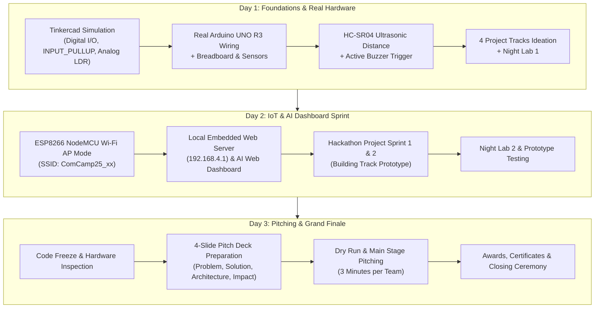

# ComCamp #25 — Project Handoff Documentation & Technical Specification
## เอกสารส่งมอบโครงการและข้อกำหนดทางเทคนิค ค่ายยุวชนคอมพิวเตอร์ ครั้งที่ 25

> **Repository:** [https://github.com/numcayX2/Comcamp-25th.git](https://github.com/numcayX2/Comcamp-25th.git)  
> **Host Organization:** สาขาวิชาวิทยาการคอมพิวเตอร์ คณะวิทยาศาสตร์ มหาวิทยาลัยแม่โจ้ (Computer Science Department, Faculty of Science, Maejo University)  
> **Last Updated (อัปเดตล่าสุด):** 17 พฤศจิกายน 2569 (2026-11-17 · แก้ไขสถานะให้ตรงโค้ดจริง commit `5eb8b14` — เดิมระบุ `f0f25d5`)  
> **Target Audience:** Frontend Engineers, Go Backend Engineers, Design/Marketing Teams, Camp Organizers (พี่ค่าย)

---

## 0. Executive Summary: What We Have Done & What Is Left (สรุปความคืบหน้าและงานที่เหลือ)

> **อัปเดตสถานะ 2026-11-17 (commit `5eb8b14`):** รายการ PENDING ด้านล่างยังสะท้อนโค้ด ณ `f0f25d5` อยู่ — ข้อ **1** (กำหนดการ `18 พ.ย.–18 ธ.ค. 2569` + `registrationCloseAt` + migration `000008`) และข้อ **6** (ฟิลด์ผู้ปกครอง `parentName`/`parentRelation`/`parentPhone` ครบ `/register` → Go/PostgreSQL → `/admin` → CSV) **เสร็จแล้ว** พร้อมระบบ reverify สลิปและตาราง Admin 6 คอลัมน์ ข้อที่เหลือยังค้างตามเดิม (รายการด้านล่างยังไม่ได้กรีดกลับเพื่อรักษาบริบทการประชุม — ให้ใช้บล็อกนี้เป็นแหล่งความจริงล่าสุด) เป้าหมาย deploy จริงคือ **rootless Docker ที่พอร์ต 6000** บน `202.28.37.1` โดเมนทดสอบ `https://comcampdev.csmju.com` — รายละเอียดอยู่ใน [`deploy/FACULTY-ROOTLESS.md`](deploy/FACULTY-ROOTLESS.md)

### ✅ สิ่งที่ดำเนินการเสร็จสิ้นแล้ว (COMPLETED — ตรงตามโค้ดจริงถึง `f0f25d5`)

1. **หน้าโฮมเพจ Flagship (`HomePage.astro`, `HeroSection.astro`, `SiteNav.astro`, `public/theme/*`)**
   - **Hero 3D (`HeroSection.astro` + `src/scripts/hero-3d.js`):** แสดงบอร์ด **ESP8266 NodeMCU** ([`esp8266.glb`](frontend/public/models/esp8266.glb)) และ **Arduino UNO R3** ([`ArduinoR3.glb`](frontend/public/models/ArduinoR3.glb)) ใน WebGL canvas เดียวทรงตัว V (`HERO_3D_CONFIG`) พร้อม self-hosted Draco decoder ([`frontend/public/draco/gltf/`](frontend/public/draco/gltf/draco_decoder.js)), `fitRig()` auto-framing, mouse parallax, drag/touch-to-rotate, keyboard arrow rotation, `IntersectionObserver` หยุด render เมื่อเลื่อนพ้นจอ และ `prefers-reduced-motion` static fallback
   - **Hero Typography, Animations & Zero-CLS:** หัวข้อ `Comcamp 25th` ใช้ **`@fontsource/space-grotesk` (`700`)** (แทน `@fontsource/pixelify-sans` เดิม — ปัจจุบันไม่มีไฟล์ใดใน `src/` หรือ `public/` import `@fontsource/pixelify-sans` แล้ว) พร้อม **ScrambleText** animation และคำบรรยาย `.hero__sub` ใช้ **GSAP `SplitText`** เลื่อนเข้าจากขวาไปซ้าย (`x: 44`, `mask: 'lines'`, `aria: 'none'`) หลัง `document.fonts.ready`; โลโก้ใช้ `<picture>` เสิร์ฟ WebP ([`comcamp25-logo-sm.webp`](frontend/public/assets/logo/comcamp25-logo-sm.webp)) พร้อม PNG fallback; preloads `.woff2` 5 ไฟล์ (`thai400`, `thai700`, `mono500`, `mono600`, `grotesk700`), defer การโหลด `hero-3d.js` หลัง `load` + `requestIdleCallback` เพื่อไม่แย่ง bandwidth จาก LCP, ล็อกขนาด `.hero__copy` / `.hero__stage-wrap` กัน CLS, และทำ pre-paint `.veil` bypass (`veil-skip`) สำหรับการเปิดซ้ำ / anchor jump / `prefers-reduced-motion` / `Save-Data`
   - **Navbar & Mobile ToC Drawer (`SiteNav.astro` + `main.js`):**
     - บนหน้าแรกใช้ `.site-nav.is-home { position: fixed !important }` ทำให้ `.hero` สูง `100svh` พอดีที่ `y = 0` และเลื่อนหลบอัตโนมัติเมื่อเข้า `#gallery`
     - ปุ่ม CTA ทรง **Full Pill (`border-radius: 9999px`)**, ปุ่มสลับ Light / Dark Mode (`comcamp-theme` ใน `localStorage`), และลิงก์หมวด `02`–`07` ตรง 1-ต่อ-1 กับ section บนหน้า (`02 กิจกรรม` `#experience`, `03 ข้อมูล` `#essentials`, `04 เส้นทาง` `#journey`, `05 ไทม์ไลน์` `#timeline`, `06 FAQ` `#faq`, `07 แกลเลอรี` `#gallery`) พร้อม scroll-spy (`aria-current="true"`)
     - Mobile Drawer (`< 900px`) แบบ Editorial Table-of-Contents เต็มจอ พร้อมซิงค์ `inert` (`syncInert`), lock body scroll, ปิดด้วย `Esc`, ปุ่ม Mobile Quick CTA (`#sticky-cta`), และปุ่มลอย [`BackToTop.astro`](frontend/src/components/BackToTop.astro) (`< 768px`)
   - **Pre-Open `/register` Gating & Server Sync:** ซิงค์ `GET /api/settings/public` ผ่าน shared 1.5 วินาที burst cache ([`public-settings-cache.ts`](frontend/src/lib/public-settings-cache.ts)) และซ่อนลิงก์ `[data-register-link]` บนหน้าแรกก่อนเปิดรับสมัครจริงผ่าน `html[data-home-page="1"]:not([data-reg-open="true"]) [data-register-link] { display: none !important }` พร้อมซิงค์ `[data-nav-register]`, `[data-nav-status]`, `[data-register-cta]`, `#cta-primary`, `#cta-secondary`, `#sticky-cta`, `#bento-seats-num` และ `[data-camp-fee-num]` ตาม state (`PRE_OPEN` / `OPEN` / `ALMOST_FULL` / `FULL` / `CLOSED`)
   - **Editorial Minimalism & Contrast Fixes (`editorial.css` โหลดต่อจาก `styles.css` และ `page.css`):**
     - ใช้โทน **Warm Alabaster (`--canvas-0: #F4F4F6` / `#0B0F19`)** สลับกับ **`--canvas-1: #F2F0E8` / `#121724`** บน `#essentials` (`03`) และ `#timeline` (`05`) โดยจัด 2 คอลัมน์ `4fr` (sticky left margin) / `8fr` (right architectural ledger) และแก้ไขคอนทราสต์ข้อความเตือน `--amber-text: #9A4608` (Light Mode ≥ 5.6:1, Dark Mode `#F5A524`)
     - Section `02` (`#experience`): Editorial chapter list `01–04` พร้อม Datasheet spec strip
     - Section `03` (`#essentials`): แถบ `.ed-metrics`, กริด 2 คอลัมน์, High-Contrast Focal Anchor Plate `.bento-feature` (`30 ที่นั่ง`) และแถบภาพห้องแล็บจริง 3 ภาพ (`g04.jpg`, `g05.jpg`, `g34.jpg` ผ่าน CDN + local WebP `srcset` + `onerror` fallback)
     - **Section `04` (`#journey`) ใช้ Editorial Option C:** `.journey.journey--typo` พร้อม `.step-big-num` scrubbed parallax, staged reveal, active/done step spy และ `.ed-journey-signoff` (ไม่มีลิงก์ `/register`)
     - Section `05` (`#timeline`): แยก **Part A (`01–04`)** และ **Part B (Parental Assurance 4 ด้าน + `.tm-status-note`)**
     - Section `06` (`#faq`) + Pre-Gallery Conversion CTA Band (`.ed-cta-band`) + Colophon Footer (`.ed-footer`)
     - **Memory Tunnel 3D Gallery (`#gallery`)** คงไว้ตามโครงสร้างเดิม (ไม่ผูก GSAP ScrollTrigger ทับ) พร้อม 43 รูป (`g01.jpg`–`g43.jpg`) และฉากจบ *"แล้วพบกัน"* → `/status`; `initEditorialMotion()` ใน `main.js` ทำงานภายใต้ `gsap.matchMedia('(prefers-reduced-motion: no-preference)')` พร้อม `ScrollTrigger.batch` safety sweep และ desktop-only (`>= 900px`) `--py` parallax

2. **ระบบฝากรูปภาพแกลเลอรีบน Cloudflare CDN พร้อม Local Fallback**
   - Deploy รูปแกลเลอรีทั้ง 43 รูป (`g01.jpg`–`g43.jpg`) ขึ้น **Cloudflare Workers Static Assets** ที่ URL: `https://comcamp25-gallery.sokulshop5.workers.dev/`
   - ผูกตัวแปร `PUBLIC_GALLERY_BASE_URL` เข้ากับ [`.env.example`](.env.example), [`frontend/.env`](frontend/.env), [`HomePage.astro`](frontend/src/components/HomePage.astro) และ [`main.js`](frontend/public/theme/main.js) พร้อม `onerror` สลับไปไฟล์สำรองในเครื่อง (`/assets/gallery/gXX.jpg`) อัตโนมัติ
   - อัปเดต [`.gitignore`](.gitignore) และ [`frontend/.gitignore`](frontend/.gitignore) เพื่อยกเว้น `frontend/public/assets/gallery/`, `backend/uploads/`, `.commandcode/`, `.archify/`, `scratch/` และ `AGENTS.md`

3. **ระบบรับสมัคร (`/register`), ตรวจสอบสถานะ/สลิป (`/status`) และแอดมิน (`/admin`)**
   - **`/register` ([`RegisterSection.tsx`](frontend/src/components/RegisterSection.tsx) + [`register/`](frontend/src/components/register/model.ts)):**
     - Wizard 5 ขั้นตอน + Step 06 ใบตอบรับ/ชำระเงิน ([`Receipt.tsx`](frontend/src/components/register/Receipt.tsx)), Server-Authoritative Pre-Open Gate + Auto-open Countdown + Midnight Zero Jitter Buffer (`200–2000ms`), Mod-11 Thai National ID & 10-digit Phone Validation (ตัดอักขระล่องหน/ขีดคั่น/เลขไทย), `X-Idempotency-Key` UUID v4, Cloudflare Turnstile explicit render ([`TurnstileField.tsx`](frontend/src/components/register/TurnstileField.tsx)), และ Self-service Withdraw
     - เพิ่มฟิลด์ **`allergies`** (หมายเหตุการแพ้อาหาร) และ **`medicalConditions`** (หมายเหตุโรคประจำตัว) ใน Step 04 (`ALLERGIES_MAX = 500`, `MEDICAL_CONDITIONS_MAX = 500`) พร้อม **PDPA-safe `sessionStorage` draft allowlist** ใน [`storage.ts`](frontend/src/components/register/storage.ts) (ไม่เก็บ `nationalId`, `motivation`, `allergies`, `medicalConditions` หรือ consent tick ลง browser storage และล้าง legacy `localStorage` draft อัตโนมัติ)
   - **`/status` ([`StatusSection.tsx`](frontend/src/components/StatusSection.tsx) + [`slip/`](frontend/src/components/slip/SlipUploadPanel.tsx)):**
     - ค้นหา In-App Browser Safe (`nationalId` / `phone` / `CC25-XXXXXX`), Single-track Status Highlight, อัปโหลดสลิปผ่าน [`SlipUploadPanel.tsx`](frontend/src/components/slip/SlipUploadPanel.tsx) (ย่อรูปเกิน `1600px` / PNG / `> 300KB` เป็น WebP/JPEG ในเบราว์เซอร์, ตัด EXIF, drag/paste, Lightbox `100%/150%/200%` ใน [`SlipLightbox.tsx`](frontend/src/components/slip/SlipLightbox.tsx), ใช้ `verifyCode` 4 ตัวท้ายบัตรใน memory เท่านั้นผ่าน [`VerifyCodeField.tsx`](frontend/src/components/slip/VerifyCodeField.tsx)), แก้ไขข้อมูลทั่วไป (`PATCH /api/applications/:id/profile`), และยกเลิกใบสมัครเอง (`POST /api/applications/:id/withdraw`)
   - **`/admin` ([`AdminSection.tsx`](frontend/src/components/AdminSection.tsx), [`AdminSettingsPanel.tsx`](frontend/src/components/AdminSettingsPanel.tsx), [`AdminProfileEditor.tsx`](frontend/src/components/AdminProfileEditor.tsx)):**
     - JWT Auth (`sessionStorage`, 8 ชม.) เฉพาะบทบาทเดียว `'admin'`, Summary metrics + Filter tabs (`ALL`, `SLIP_PENDING`, `PASSED`, `CONFIRMED`, `RESERVE`, `REJECTED`, `REFUND_PENDING`, `REFUNDED`, และ `PENDING` เมื่อมี) + Search + Sort (`newest`, `slip_queue`, `updated_desc`)
     - **1-click Slip Approval / 2-step Reject Confirmation:** อนุมัติสลิป 1 คลิกเปลี่ยนเป็น `CONFIRMED` พร้อม auto-advance คิวถัดไป; ปฏิเสธสลิปมีขั้นยืนยันที่ 2 และบังคับกรอกหมายเหตุ, ผูก `paymentId` (`X-Slip-Payment-Id`) ป้องกัน `409 SLIP_CHANGED`, โหลดสลิปผ่าน Authorized Blob + `SlipLightbox`
     - Inline Detail Panel & Profile Editor (แสดง/แก้ไข `allergies`, `medicalConditions`, `motivation` พร้อม dirty-state guard), Admin Settings Panel (ตั้งค่าวันเปิด/ปิด, วันปล่อยเกียรติบัตร, `maxCapacity`, `campFee`, สวิตช์ปิดฉุกเฉิน), และ **ส่งออก CSV** ([`applicant-tools.ts`](frontend/src/lib/applicant-tools.ts) — `UTF-8 BOM`, `RFC 4180`, CSV injection escaping ครบคอลัมน์ `การแพ้อาหาร` และ `โรคประจำตัว`, บันทึก `POST /api/admin/applications/export-audit` ก่อนดาวน์โหลด)
   - **Synchronous Double-Submit Locks + Loading Labels บนทุกปุ่ม:** ใช้ `useRef` guards แบบ synchronous (`submittingRef`, `busyRef`, `searchBusyRef`, `editBusyRef`, `withdrawBusyRef`, `loginBusyRef`, `refreshBusyRef`, `patchingRef`, `verifyingBusyRef`, `deletingRef`, `exportBusyRef`, `savingRef`, `togglingRef`) ร่วมกับ `disabled`, `aria-busy` และข้อความโหลด (`กำลังส่งใบสมัคร…`, `กำลังค้นหา…`, `กำลังบันทึก…`, `กำลังยกเลิก…`, `กำลังส่งสลิป… %`, `กำลังเข้าสู่ระบบ…`, `กำลังโหลด…`, `กำลังอนุมัติ…`, `กำลังปฏิเสธ…`, `กำลังลบ…`, `กำลังส่งออก…`)

4. **ระบบ Go Backend (`backend/`), Database Migrations 000001–000007, Security Hardening & Production Deploy**
   - Go `1.27.3` Clean Architecture (`cmd/api`, `cmd/create-admin`, `internal/{config,docs,domain,handler,middleware,pkg/response,repository,server,service}`) พร้อม **7 คู่ SQL Migrations (`000001`–`000007`)** ใน [`backend/migrations/`](backend/migrations/) และ OpenAPI Spec ([`backend/docs/openapi.json`](backend/docs/openapi.json))
   - แก้ไขประเด็นความปลอดภัยจาก Staging Pentest (F-01..F-04) ใน [`remediation_f03_test.go`](backend/internal/handler/remediation_f03_test.go), [`verify_slip_test.go`](backend/internal/service/verify_slip_test.go), [`applicant-tools.test.ts`](frontend/src/lib/applicant-tools.test.ts), และเพิ่ม **`TestSecurity_TwoAdmins_TokenCannotImpersonate`** ใน [`backend/internal/handler/rbac_test.go`](backend/internal/handler/rbac_test.go) (ยืนยันว่า 2 บัญชีแอดมินแปลง JWT payload ข้ามกันไม่ได้ `401`, audit log บันทึก `adminID` จริง, และระงับบัญชีแล้ว token ถูกปฏิเสธทันทีโดยไม่กระทบแอดมินอีกคน)
   - เพิ่ม Security Headers / Cache Rules ([`frontend/nginx/default.conf`](frontend/nginx/default.conf), [`frontend/nginx/snippets/security-headers.conf`](frontend/nginx/snippets/security-headers.conf), [`frontend/public/_headers`](frontend/public/_headers)) และชุดติดตั้ง Production Docker ([`docker-compose.prod.yml`](docker-compose.prod.yml), [`backend/Dockerfile`](backend/Dockerfile), [`frontend/Dockerfile`](frontend/Dockerfile), [`deploy/nginx/edge.conf`](deploy/nginx/edge.conf), [`deploy/postgres-init/01-run-up-migrations.sh`](deploy/postgres-init/01-run-up-migrations.sh), [`.env.prod.example`](.env.prod.example), [`deploy/RUNBOOK.md`](deploy/RUNBOOK.md))

---

### 📋 สิ่งที่ต้องดำเนินการต่อ (PENDING — มติหลังประชุม 2026-11-16 ยังไม่ได้ลงมือแก้โค้ด)

1. **อัปเดตกำหนดการรับสมัครใหม่ (`18 พ.ย. 2569` – `18 ธ.ค. 2569`, เต็มก่อนปิดก่อนทันที):**
   - เพิ่ม DB migration (`000008+`) อัปเดต `registration_open_at = '2026-11-18 00:00:00+07'` และ `registration_close_at = '2026-12-18 23:59:59+07'` + ส่ง `registrationCloseAt` ใน `GET /api/settings/public`
   - อัปเดตวันที่/Countdown ใน [`HeroSection.astro`](frontend/src/components/HeroSection.astro), [`HomePage.astro`](frontend/src/components/HomePage.astro), [`SiteNav.astro`](frontend/src/components/SiteNav.astro), [`BaseLayout.astro`](frontend/src/layouts/BaseLayout.astro), [`RegisterSection.tsx`](frontend/src/components/RegisterSection.tsx), [`api.ts`](frontend/src/lib/api.ts), [`main.js`](frontend/public/theme/main.js), และ [`deploy/RUNBOOK.md`](deploy/RUNBOOK.md) จากค่าเดิม `16 พ.ย. 69` เป็น **เปิดรับ `18 พ.ย. 2569` – ปิดรับ `18 ธ.ค. 2569` (เต็ม 30 ที่นั่งก่อน ปิดก่อนทันที)**
2. **วันจัดค่ายจริง (`5–7 กุมภาพันธ์ 2570`, 3 วัน 2 คืน):** ใส่วันจัดค่ายลงใน [`HomePage.astro`](frontend/src/components/HomePage.astro) (Hero, Section 03, Section 05) และนำออกจากป้าย *"รอประกาศเพิ่มเติม"*
3. **กติกาโอนเงินภายใน `3 วัน` หลังสมัคร (เกิน 3 วันคืนที่นั่งว่างอัตโนมัติ):**
   - พัฒนาตัวตรวจหมดเวลาชำระเงินฝั่ง Go Backend (`created_at + 72h`) เปลี่ยนสถานะใบสมัครที่ **ยังไม่ส่งสลิป** เป็น `REJECTED` พร้อมบันทึก `applicant_status_logs` + `audit_logs` (`"พ้นกำหนดชำระเงิน 3 วัน"`) และล้าง cache โควตาเพื่อคืนที่นั่งให้สมัครใหม่ได้ทันที (*ห้ามตัดสิทธิ์ผู้ที่ส่งสลิปแล้ว `PENDING` / `APPROVED`*)
   - แสดงกำหนดเวลาโอน (`3 วันหลังสมัคร` / วันครบกำหนด) บนหน้าแรก, [`RegisterSection.tsx`](frontend/src/components/RegisterSection.tsx), [`Receipt.tsx`](frontend/src/components/register/Receipt.tsx) และ [`StatusSection.tsx`](frontend/src/components/StatusSection.tsx)
4. **กล่องเตือนข้อกำหนด 4 ข้อหน้าแรกของ `/register` & นโยบาย "โอนแล้วสละสิทธิ์ไม่คืนเงินทุกกรณี":**
   - เพิ่มกล่องสรุปข้อกำหนดสำคัญ 4 ข้อบนสุดของ `/register` Step 01 เหนือช่องกรอกชื่อ (วันจัดค่าย `5–7 ก.พ. 2570`, เกณฑ์ `30 ที่นั่ง` เต็มก่อนปิดก่อน `18 ธ.ค. 69`, โอนภายใน `3 วัน` เกินคืนที่นั่ง, และโอนแล้วไม่คืนเงิน)
   - ย้ำข้อความยินยอมใน Step 05 Consent, เหนือเลขบัญชีบนใบตอบรับ ([`Receipt.tsx`](frontend/src/components/register/Receipt.tsx)), [`StatusSection.tsx`](frontend/src/components/StatusSection.tsx) และ [`HomePage.astro`](frontend/src/components/HomePage.astro) ว่า **โอนแล้วสละสิทธิ์ไม่คืนเงินทุกกรณี** (ลบข้อความเดิมที่เขียนว่า *"เพื่อขอยกเลิกและคืนเงิน"* / *"ขอคืนเงิน"* ออกจาก [`Receipt.tsx`](frontend/src/components/register/Receipt.tsx) และ [`StatusSection.tsx`](frontend/src/components/StatusSection.tsx))
5. **เน้นรายละเอียดอาหารในช่อง `allergies`:** เพิ่มตัวเลือกด่วน/คำแนะนำชัดเจนใน [`RegisterSection.tsx`](frontend/src/components/RegisterSection.tsx) ให้ครอบคลุม **แพ้อาหาร** และ **ไม่ทานหมู / ฮาลาล / มังสวิรัติ**
6. **เพิ่มฟอร์มกรอกช่องทางติดต่อผู้ปกครองใน `/register` + Backend + `/admin`:**
   - ต้องเพิ่มฟิลด์ให้กรอก **ผู้ปกครอง 1 คน (ชื่อ/ความสัมพันธ์) + เบอร์โทรศัพท์ติดต่อผู้ปกครอง (10 หลัก)** ใน [`RegisterSection.tsx`](frontend/src/components/RegisterSection.tsx) / [`model.ts`](frontend/src/components/register/model.ts), [`ApplicationPayload`](frontend/src/lib/api.ts) และ [`ApplicationCreateRequest`](backend/internal/service/applicant_service.go) รวมถึงแสดง/แก้ไขใน `/admin`
   - ปัจจุบันตาราง `applicants` ในฐานข้อมูลมีคอลัมน์ `parent_name`, `parent_relation`, `parent_phone`, `emergency_contact`, `emergency_phone` รองรับอยู่แล้ว แต่หน้า `/register` และ Backend API ยังไม่ได้รับค่าจากผู้ใช้จริง (ตอนนี้ [`applicant_service.go`](backend/internal/service/applicant_service.go) ตั้ง `EmergencyContact: "ผู้ปกครอง"` และคัดลอก `EmergencyPhone: req.Phone` เป็นค่าชั่วคราว)
7. **ข้อมูลทางการที่ยังรอรับจากทีมงานเพื่อเติมลงเว็บ (TBD / `TODO(content)`):**
   - **รายละเอียดติดต่อ Staff** (ชื่อ/เบอร์/ช่องทางสอบถาม) และ **ลิงก์ LINE OpenChat** ของโครงการ (บนหน้าแรก, [`Receipt.tsx`](frontend/src/components/register/Receipt.tsx), [`StatusSection.tsx`](frontend/src/components/StatusSection.tsx))
   - **ชื่ออาคาร/ห้องปฏิบัติการ/ห้องลงทะเบียน, หอพักแยกชาย-หญิง, และเบอร์โทรศัพท์อาจารย์ผู้รับผิดชอบ** ใน [`HomePage.astro`](frontend/src/components/HomePage.astro)
   - **ค่าสมัครสุทธิและรายการสิทธิประโยชน์** — ปัจจุบันตั้งค่าเบื้องต้นไว้ที่ `1,000 บาท` (ยังไม่คอนเฟิร์มอย่างเป็นทางการและอาจเปลี่ยนแปลงได้) และตรวจทานเลขบัญชีธนาคารใน [`payment.ts`](frontend/src/lib/payment.ts) ให้ถูกต้องก่อนวันเปิดรับสมัครจริง
   - **เสื้อค่าย (มีแน่นอน · คอนเฟิร์มแล้ว)** — รอทีมงานยืนยันเฉพาะรายการไซส์ที่จะมีจริงและตารางรอบอก (`XS / 2XL / 3XL` และตรวจทาน `S–XL`)
8. **การนำขึ้นระบบจริง (Production Deployment & End-to-End QA):**
   - ทดสอบ Build/Boot ชุด Production Docker จริง (`docker compose -f docker-compose.prod.yml --env-file .env.prod up -d --build`) และสร้างบัญชีแอดมินผ่าน `/app/create-admin` ตาม [`deploy/RUNBOOK.md`](deploy/RUNBOOK.md)
   - ทดสอบ E2E ครบวงจรก่อนวันเปิดรับสมัคร **18 พฤศจิกายน 2569 เวลา 00:00:00 น.**

---

## 1. Project Overview (ภาพรวมโครงการ)

**ComCamp #25 (ค่ายยุวชนคอมพิวเตอร์ ครั้งที่ 25)** เป็นค่ายวิชาการเชิงปฏิบัติการ (Hands-on Workshop & Hackathon) ระยะเวลา **3 วัน 2 คืน** จัดโดยสาขาวิชาวิทยาการคอมพิวเตอร์ คณะวิทยาศาสตร์ มหาวิทยาลัยแม่โจ้ เพื่อเปิดโอกาสให้นักเรียนระดับมัธยมศึกษาตอนปลายและอาชีวศึกษาได้เรียนรู้การเขียนโปรแกรม การต่อวงจรฮาร์ดแวร์ไมโครคอนโทรลเลอร์ (Arduino UNO R3 & ESP8266 NodeMCU), ระบบ IoT (Internet of Things) และการสร้างหน้าเว็บ AI Dashboard ควบคุมอุปกรณ์ผ่านสมาร์ตโฟน โดยมุ่งเน้นการลงมือปฏิบัติจริงโดยไม่จำเป็นต้องมีพื้นฐานมาก่อน

*(ดูเอกสารสถาปัตยกรรมระบบร่วมฉบับเต็มได้ที่ [`ComCamp.md`](ComCamp.md) และมาตรฐานวิศวกรรม Frontend/Security ได้ที่ [`AGENTS.md`](AGENTS.md))*

---

## 2. Confirmed Camp Specifications & Tentative Items (ข้อกำหนดค่ายที่ยืนยันแล้ว และข้อมูลที่รอการยืนยัน)

*สถานะข้อมูลอ้างอิง ณ วันที่ 16 พฤศจิกายน 2569 (Status as of 2026-11-16 — มติหลังประชุมทีมงาน)*

| Parameter (หัวข้อ) | Confirmed Value (ข้อมูลที่ยืนยันแล้ว) | Status / Notes (สถานะ / หมายเหตุ) |
|---|---|---|
| **Application Open Date (วันเปิดรับสมัคร)** | **18 พฤศจิกายน 2569 เวลา 00:00:00 น.** (`2026-11-18T00:00:00+07:00`) | ✅ **Confirmed in Meeting** · ⏳ **Pending Code/DB Update** *(โค้ด/DB ปัจจุบันยังตั้ง 16 พ.ย. 2569)* |
| **Application Close Date (วันปิดรับสมัคร)** | **18 ธันวาคม 2569** (`2026-12-18T23:59:59+07:00`, **เต็มก่อนปิดก่อน**) | ✅ **Confirmed in Meeting** · ⏳ **Pending Code/DB Update** |
| **Seat Quota (จำนวนที่เปิดรับ)** | **30 คน** (30 seats — First-Come, First-Served) | ✅ **Confirmed** (ปรับแก้ชั่วคราวได้ผ่าน `/admin`) |
| **Eligibility (คุณสมบัติผู้สมัคร)** | **ม.4 – ม.6** และ **ปวช.1 – ปวช.3** | ✅ **Confirmed** (ไม่จำกัดสายการเรียน ไม่จำเป็นต้องมีพื้นฐานมาก่อน) |
| **Camp Duration & Dates (ระยะเวลา / วันจัดค่ายจริง)** | **3 วัน 2 คืน — วันที่ 5, 6, 7 กุมภาพันธ์ 2570** (`5–7 Feb 2027`) | ✅ **Confirmed in Meeting** · ⏳ **Pending Web Copy Update** |
| **Payment & Refund Policy (กำหนดโอน / คืนเงิน)** | **โอนภายใน 3 วันหลังสมัคร** (เกิน 3 วันคืนที่นั่งว่างอัตโนมัติ) · **โอนแล้วสละสิทธิ์ไม่คืนเงิน** | ✅ **Confirmed in Meeting** · ⏳ **Pending Code & Payment Notice Update** |
| **Registration Fee (ค่าใช้จ่าย)** | เบื้องต้น **1,000 บาท** (อาจเปลี่ยนแปลงได้; รายการที่รวมในค่าสมัคร เช่น ที่พัก/อาหาร/ชุดอุปกรณ์ รอประกาศยืนยัน) | ⏳ **Pending Official Confirmation** (ยังไม่คอนเฟิร์มราคา 1,000 บาท ปรับแก้ได้ใน `/admin`) |
| **Camp Shirt (เสื้อค่าย)** | **มีเสื้อค่ายแน่นอน (Confirmed)** · หน้า `/register` เก็บไซส์เบื้องต้น (`XS–3XL`) | ⏳ **Sizes TBD** (มีเสื้อแล้ว รอคอนเฟิร์มรายการไซส์ที่มีจริงและตารางรอบอก) |
| **Food / Dietary & Health Notes** | ฟิลด์ `allergies` และ `medicalConditions` เก็บเข้า DB และส่งออก CSV แล้ว — ต้องเน้นตัวเลือก **แพ้อาหาร / ไม่ทานหมู (อิสลาม)** | ✅ **DB/Form/CSV Ready** · ⏳ **Pending Quick-Option UI in `/register`** |
| **Parent Contact (ผู้ปกครอง 1 คน + เบอร์โทร)** | DB มี `parent_name`, `parent_relation`, `parent_phone` แล้ว | ⏳ **Pending UI/API Wiring** *(ปัจจุบัน Backend ใส่ค่าชั่วคราวจากเบอร์ผู้สมัคร)* |
| **Venue & Dormitory Details (อาคารเรียน/หอพัก)** | สาขาวิชาวิทยาการคอมพิวเตอร์ คณะวิทยาศาสตร์ มหาวิทยาลัยแม่โจ้ | ⏳ **Pending Specific Room & Dormitory Names** |
| **Contact Channels (ช่องทางติดต่อ)** | เพจ Facebook (`CCCSMJU`) / **ข้อมูลติดต่อ Staff (รอรายละเอียด)** / **LINE OpenChat (รอเพิ่มลิงก์)** / เบอร์อาจารย์ผู้รับผิดชอบ | ⏳ **Pending Staff Details, Advisor Phone & LINE OpenChat Link** |

### 2.1 Curriculum & Schedule (หลักสูตรและการเรียนรู้ 3 วัน 2 คืน)



---

## 3. Monorepo Architecture, Tech Stack & Route Status (สถาปัตยกรรมและสถานะหน้าเว็บ)

### 3.1 Verified Dependency Versions (`frontend/package.json` & `backend/go.mod`)

- **Frontend Runtime & Core:** Node.js `>=22.23.4`, **Astro `^7.4.4`**, **React `^19.3.1`** (`@astrojs/react: ^7.1.2`), **Tailwind CSS v4 (`^4.3.3` + `@tailwindcss/vite: ^4.3.3`)**, **TypeScript `^7.0.2`**
- **Frontend Motion, 3D & Icons:** **GSAP `^3.15.1`** (bundle `gsap/SplitText` สำหรับ Hero และ `SizeChips.tsx` + CDN GSAP/ScrollTrigger `3.12.5` พร้อม SRI ใน `HomePage.astro` สำหรับ `main.js`), **Three.js `^0.187.0`**, **Lucide React `^1.66.0`**
- **Self-Hosted Fonts (`frontend/src/styles/fonts.css` & `HeroSection.astro`):** `@fontsource/ibm-plex-sans-thai` (`^5.3.0`), `@fontsource/ibm-plex-mono` (`^5.3.0`), **`@fontsource/space-grotesk` (`^5.3.0`, weight `700` สำหรับ Hero title)**
- **Backend (`backend/go.mod`):** **Go `1.27.3`**, `go-chi/chi/v5 v5.5.0`, `go-chi/cors v1.2.2`, `golang-jwt/jwt/v5 v5.3.1`, `google/uuid v1.6.0`, `jackc/pgx/v5 v5.12.0`, `joho/godotenv v1.5.1`, `shopspring/decimal v1.6.0`, `golang.org/x/crypto v0.58.0`

### 3.2 Directory Tree (ตรงตาม Repository ปัจจุบัน)

```text
Comcamp-site/
├── .env.example                    # ตัวอย่าง Env พัฒนาบนเครื่อง (DB, JWT, Turnstile, PUBLIC_*)
├── .env.prod.example               # ตัวอย่าง Env Production (ต้องตั้งรหัสลับจริงก่อน deploy)
├── .gitattributes                  # บังคับ LF สำหรับ .sh, .conf, .sql, .yml, Dockerfile, _headers
├── .gitignore                      # ยกเว้น .env, node_modules, dist, uploads, gallery local cache, AGENTS.md
├── AI_SETUP.md                     # คู่มือให้ AI Agent ช่วยเซตอัพและตรวจระบบ (โหมด A In-Memory / โหมด B Docker)
├── AGENTS.md                       # กฎวิศวกรรม Frontend/Security (Ignored ใน Git)
├── ComCamp.md                      # System Specification ฉบับรวม (v3.0)
├── HANDOFF.md                      # เอกสารส่งมอบโครงการฉบับนี้
├── README.md                       # คู่มือภาพรวมและการเริ่มต้นใช้งาน
├── docker-compose.yml              # PostgreSQL 16 Alpine สำหรับพัฒนาบนเครื่อง (127.0.0.1:5432)
├── docker-compose.prod.yml         # Production stack: db + backend + frontend + edge-proxy (internal nets)
├── deploy/
│   ├── RUNBOOK.md                  # คู่มือติดตั้ง/สำรองข้อมูล/กู้คืนบนเซิร์ฟเวอร์ภาควิชา
│   ├── nginx/edge.conf             # Reverse proxy ภายใน (บล็อก /swagger /docs, ส่งต่อ /api และ /)
│   └── postgres-init/
│       └── 01-run-up-migrations.sh # รัน SQL migrations 000001–000007 อัตโนมัติเมื่อ init DB ครั้งแรก
├── backend/                        # ระบบหลังบ้าน Go 1.27.3 Clean Architecture + PostgreSQL 16
│   ├── Dockerfile                  # Multi-stage static Go build + non-root runtime (UID 10001)
│   ├── go.mod / go.sum
│   ├── README.md                   # คู่มือ API Screen Mapping, Security และ Benchmarks
│   ├── cmd/
│   │   ├── api/main.go             # Entrypoint ของ Go HTTP Server (:8000, fail-closed in production)
│   │   └── create-admin/main.go    # CLI สร้าง/รีเซ็ตบัญชีแอดมิน (bcrypt, role 'admin' เท่านั้น)
│   ├── docs/openapi.json           # OpenAPI 3.0.3 Specification
│   ├── internal/                   # config, docs, domain, handler (รวม rbac_test.go), middleware, pkg/response, repository, server, service
│   └── migrations/                 # 7 คู่ SQL Schema Migrations (000001–000007, .up.sql / .down.sql)
│       ├── 000001_init_schema.{up,down}.sql
│       ├── 000002_security_hardening.{up,down}.sql
│       ├── 000003_soft_delete_identity.{up,down}.sql
│       ├── 000004_refund_statuses.{up,down}.sql
│       ├── 000005_allow_rejected_slip_reupload.{up,down}.sql
│       ├── 000006_release_deleted_applicant_slips.{up,down}.sql
│       └── 000007_single_admin_role.{up,down}.sql
└── frontend/                       # Astro 7.4.4 + React 19.3.1 + Tailwind CSS v4 + Three.js + GSAP
    ├── astro.config.mjs            # อ่าน PUBLIC_* จาก root .env อัตโนมัติเป็น fallback
    ├── Dockerfile                  # Multi-stage Astro build + Nginx 1.27 non-root (:4321)
    ├── package.json
    ├── .gitignore
    ├── nginx/
    │   ├── default.conf            # Cache-Control: no-store สำหรับ /admin /status /register, immutable สำหรับ /_astro/
    │   └── snippets/security-headers.conf # CSP, X-Frame-Options: DENY, nosniff, Referrer-Policy
    ├── public/
    │   ├── _headers                # Security headers & cache rules สำหรับ Cloudflare Pages
    │   ├── assets/
    │   │   ├── gallery/            # รูปสำรอง g01.jpg–g43.jpg + WebP (Ignored ใน Git, เสิร์ฟหลักจาก CDN)
    │   │   └── logo/               # comcamp25-logo-sm.webp, comcamp25-logo-sm.png, comcamp25-logo.png
    │   ├── draco/gltf/             # Self-hosted Draco decoder (draco_decoder.{js,wasm}, draco_wasm_wrapper.js)
    │   ├── models/                 # โมเดล 3D: ArduinoR3.glb, esp8266.glb
    │   └── theme/
    │       ├── styles.css          # Master palette tokens, Hero Swiss tokens, Base & Memory Tunnel CSS
    │       ├── page.css            # Section 02 & Intro veil preloader styles
    │       ├── editorial.css       # Editorial 4fr/8fr split, --canvas-1 alternation, --amber-text, footer
    │       └── main.js             # Server sync, [data-register-cta] sync, GSAP editorial motion, Memory Tunnel & nav spy
    └── src/
        ├── layouts/
        │   └── BaseLayout.astro    # Layout สำหรับ /register, /status, /admin (Anti-FOUC + ClientRouter)
        ├── pages/                  # เส้นทางจริง 4 หน้า (ไม่มี /home)
        │   ├── index.astro         # เส้นทาง / (แสดงผล HomePage.astro)
        │   ├── register.astro      # เส้นทาง /register
        │   ├── status.astro        # เส้นทาง /status
        │   └── admin.astro         # เส้นทาง /admin
        ├── components/
        │   ├── HomePage.astro      # หน้าโฮมเพจหลัก พร้อม pre-open gating, Hero, Sections 02–06, #gallery & footer
        │   ├── HeroSection.astro   # Hero 3D + Space Grotesk 700 ScrambleText + GSAP SplitText subtitle
        │   ├── SiteNav.astro       # Fixed/Sticky Full-Pill navbar + Mobile ToC drawer + inert sync + live register state
        │   ├── BackToTop.astro     # ปุ่มเลื่อนกลับด้านบนสำหรับมือถือ (<768px)
        │   ├── RegisterSection.tsx # Wizard รับสมัคร 5 ขั้นตอน + Gate + Idempotency + double-submit ref guard
        │   ├── StatusSection.tsx   # ค้นหาสถานะ + ยืนยัน 4 หลัก + แก้ไขโปรไฟล์ + สละสิทธิ์ + สลิป
        │   ├── AdminSection.tsx    # Staff JWT dashboard + 1-click approve / 2-step reject + CSV export
        │   ├── AdminSettingsPanel.tsx # ตั้งค่ากำหนดการ โควตา ค่าค่าย และปิดรับฉุกเฉิน
        │   ├── AdminProfileEditor.tsx # แก้ไขข้อมูลผู้สมัครทุกช่อง (รวม allergies / medicalConditions)
        │   ├── admin-ui.ts         # Design tokens และ CSS class constants สำหรับ /admin
        │   ├── register/           # model.ts, parts.tsx, Receipt.tsx, SizeChips.tsx, SlipBlock.tsx, storage.ts, TurnstileField.tsx
        │   └── slip/               # SlipLightbox.tsx, SlipUploadPanel.tsx, VerifyCodeField.tsx
        ├── lib/
        │   ├── api.ts              # Shared API client + Offline Dev Fallback + Error code mapper
        │   ├── applicant-tools.ts  # Search matcher & CSV export (BOM + RFC 4180 + injection escaping)
        │   ├── applicant-tools.test.ts # Unit tests สำหรับ CSV escaping และ paymentId UUID validation
        │   ├── payment.ts          # ข้อมูลบัญชีโอนเงิน + copyText fallback สำหรับ In-App Browser
        │   ├── public-settings-cache.ts # Shared 1.5s burst cache สำหรับ GET /api/settings/public
        │   └── slip-upload.ts      # Client WebP/JPEG shrink (<=1600px), EXIF strip, Error message mapper
        ├── scripts/
        │   └── hero-3d.js          # Three.js dual-board V-shape stage (loaded lazily on idle)
        └── styles/
            ├── fonts.css           # Self-hosted IBM Plex Sans Thai (400/600/700) & IBM Plex Mono (500/600/700)
            ├── global.css          # Tailwind v4 + Warm Alabaster theme tokens + Dark mode select fixes
            ├── register.css        # Split-screen registration wizard styles
            └── slip-upload.css     # Flat hairline slip uploader & lightbox styles
```

### 3.3 Route Status Overview (สถานะปัจจุบันของแต่ละเส้นทาง — มี 4 เส้นทาง ไม่มี `/home`)

| Route | Main Files | Description | Current Status |
|---|---|---|---|
| **`/`** | [`index.astro`](frontend/src/pages/index.astro)<br/>[`HomePage.astro`](frontend/src/components/HomePage.astro)<br/>[`HeroSection.astro`](frontend/src/components/HeroSection.astro)<br/>[`SiteNav.astro`](frontend/src/components/SiteNav.astro)<br/>[`public/theme/*`](frontend/public/theme/editorial.css) | **Flagship Homepage, 3D Hero & Memory Tunnel Gallery**<br/>Hero เต็มจอ `100svh` พร้อมบอร์ด 3D (Space Grotesk Scramble + SplitText + lazy Three.js), Pre-open `/register` gating (`[data-register-link]`), Navbar 02–07 + Mobile ToC Drawer (`inert`), Editorial Sections 02–06 (Option C ใน Section 04, ภาพแล็บจริงใน Section 03) และ 3D Memory Tunnel 43 รูปจาก Cloudflare CDN | 🟢 **Core Ready** *(รออัปเดต copy วันที่ 18 พ.ย.–18 ธ.ค., วันจัดค่าย 5–7 ก.พ. 2570, กติกา 3 วัน/ไม่คืนเงิน, Staff & LINE OpenChat)* |
| **`/register`** | [`register.astro`](frontend/src/pages/register.astro)<br/>[`RegisterSection.tsx`](frontend/src/components/RegisterSection.tsx)<br/>[`register/*`](frontend/src/components/register/model.ts) | **Registration Wizard (5 Steps + Receipt)**<br/>Pre-Open Gate + Midnight Zero Jitter Buffer, Mod-11 NID + 10-digit Phone validation, `X-Idempotency-Key`, Turnstile explicit widget, `allergies` / `medicalConditions` (PDPA-safe `sessionStorage` allowlist), synchronous `useRef` submit lock, และใบตอบรับ `CC25-XXXXXX` | 🟢 **Core Ready** *(รอเพิ่ม: กล่องเตือน 4 ข้อ Step 01, ฟิลด์ติดต่อผู้ปกครอง 1 คน + เบอร์โทร, quick-hints อาหาร/ไม่ทานหมู, นโยบายไม่คืนเงิน)* |
| **`/status`** | [`status.astro`](frontend/src/pages/status.astro)<br/>[`StatusSection.tsx`](frontend/src/components/StatusSection.tsx)<br/>[`slip/*`](frontend/src/components/slip/SlipUploadPanel.tsx) | **Status Lookup, Self-Edit, Withdraw & Slip Upload**<br/>ค้นหา In-App Browser Safe (`nationalId`/`phone`/`CC25-XXXXXX`), ยืนยันตัวตน 4 หลัก (memory-only), แก้ไขข้อมูลทั่วไป, ยกเลิกใบสมัคร (13 หลัก), และอัปโหลดสลิป (WebP resize + EXIF strip + Lightbox) พร้อม `useRef` double-submit locks | 🟢 **Core Ready** *(รอเพิ่ม: แสดงกำหนดโอน 3 วัน, แก้ข้อความขอคืนเงินเป็นไม่คืนเงิน, Staff & LINE OpenChat)* |
| **`/admin`** | [`admin.astro`](frontend/src/pages/admin.astro)<br/>[`AdminSection.tsx`](frontend/src/components/AdminSection.tsx)<br/>[`AdminSettingsPanel.tsx`](frontend/src/components/AdminSettingsPanel.tsx)<br/>[`AdminProfileEditor.tsx`](frontend/src/components/AdminProfileEditor.tsx) | **Staff Dashboard (Single-Role `admin` JWT)**<br/>1-click approve / 2-step reject (`paymentId` pinned), Authorized Blob slip viewer + Lightbox, Detail & Profile Editor (`allergies`/`medicalConditions`), Settings Panel, CSV export (BOM + formula escaping + audit), พร้อม `useRef` locks บนทุกปุ่ม | 🟢 **Production-Ready** *(รอเพิ่มการแสดง/แก้ไขช่องทางติดต่อผู้ปกครองเมื่อเพิ่มฟิลด์ใหม่)* |

---

## 4. Cloudflare CDN Gallery Configuration (การตั้งค่ารูปภาพบน Cloudflare CDN)

รูปภาพบรรยากาศค่ายปีที่แล้วทั้ง 43 รูป (`g01.jpg` – `g43.jpg`) ถูกอัปโหลดขึ้น **Cloudflare Workers Static Assets** แล้ว เพื่อลดภาระแบนด์วิดท์ของเซิร์ฟเวอร์หลักและโหลดผ่าน Edge CDN ในไทยได้รวดเร็ว:

- **Production CDN Base URL:** `https://comcamp25-gallery.sokulshop5.workers.dev/`
- **Environment Variable (`.env` ที่ root หรือ `frontend/.env`):**
  ```env
  PUBLIC_API_URL=http://localhost:8000/api
  PUBLIC_GALLERY_BASE_URL=https://comcamp25-gallery.sokulshop5.workers.dev/
  ```
- **กลไก Fallback อัตโนมัติ:**
  - ใน [`main.js`](frontend/public/theme/main.js) หากรูปใน `#gallery` โหลดจาก `PUBLIC_GALLERY_BASE_URL` ไม่สำเร็จ ระบบจะสลับไป `/assets/gallery/gXX.jpg` อัตโนมัติ
  - ใน [`HomePage.astro`](frontend/src/components/HomePage.astro) Section `03` ภาพห้องแล็บ (`g04`, `g05`, `g34`) ใช้ `src` จาก CDN คู่กับ `srcset` local WebP (`-320.webp`, `-640.webp`) และ `onerror` fallback ไป `/assets/gallery/gXX.jpg`

---

## 5. Local Setup, Testing & Production Verification Guide (คู่มือการรันและตรวจสอบระบบ)

### 5.1 การรัน Frontend (`frontend/`)

[`frontend/astro.config.mjs`](frontend/astro.config.mjs) อ่านตัวแปร `PUBLIC_*` จาก `.env` ที่ root ของโปรเจกต์อัตโนมัติ (หากมี [`frontend/.env`](frontend/.env) จะใช้ค่านั้นทับ):

```bash
cd frontend
npm install
npm run dev       # http://localhost:4321
```

ทดสอบ Production Build และ Preview:
```bash
cd frontend
npm run build     # build ครบ 4 เส้นทาง (/, /register, /status, /admin)
npm run preview   # พรีวิว dist/ ในเครื่อง
```

*(หมายเหตุ: ไฟล์ทดสอบ [`frontend/src/lib/applicant-tools.test.ts`](frontend/src/lib/applicant-tools.test.ts) ใช้ `node:test` คู่กับ module resolution ที่รองรับการ import แบบไม่ระบุ `.ts`)*

### 5.2 การรันฐานข้อมูล PostgreSQL (Migrations `000001`–`000007`) และ Go Backend (`backend/`)

```bash
# 1. คัดลอก .env (ตั้ง APP_ENV=development, JWT_SECRET >= 32 ตัว, DB_PASSWORD สำหรับ Docker)
cp .env.example .env

# 2. รัน PostgreSQL 16 ผ่าน Docker (ข้ามได้หากใช้ In-Memory Mode ใน development)
docker compose up -d db
```

รัน SQL Migrations **ครบทั้ง 7 ไฟล์ (`000001`–`000007`)** ตามลำดับ:
```powershell
# Windows PowerShell
Get-ChildItem backend/migrations/*.up.sql | Sort-Object Name | ForEach-Object { Get-Content $_.FullName -Raw } | docker exec -i comcamp_db psql -U comcamp -d comcamp_db
```
```bash
# macOS / Linux
cat backend/migrations/*.up.sql | docker exec -i comcamp_db psql -U comcamp -d comcamp_db
```

สร้างบัญชีแอดมิน (เมื่อต่อ PostgreSQL; รหัสผ่าน 12–72 ตัวอักษร) และสตาร์ต Go API Server (`:8000`):
```bash
cd backend
go run ./cmd/create-admin -username admin_staff -name "พี่ค่ายดูแลระบบ" -role admin
go run ./cmd/api
```

### 5.3 การรันชุดทดสอบ Go Backend

```bash
cd backend
go vet ./...
go test -count=1 ./...

# ทดสอบความปลอดภัยข้ามบัญชีแอดมิน (2 admins)
go test -v -run TestSecurity_TwoAdmins_TokenCannotImpersonate ./internal/handler/

# Integration tests กับ PostgreSQL จริง (ต้องรัน migration 000001–000007 แล้ว)
TEST_DATABASE_DSN="host=127.0.0.1 port=5432 user=comcamp password=<DB_PASSWORD> dbname=comcamp_db sslmode=disable" go test -v -count=1 ./internal/repository/postgres/
```

### 5.4 การติดตั้ง Production (Department Server)

ดูขั้นตอนฉบับสมบูรณ์ (TLS, Reverse Proxy, `TRUSTED_PROXIES`, Turnstile production keys, Backup/Restore) ได้ใน [`deploy/RUNBOOK.md`](deploy/RUNBOOK.md) และ [`docker-compose.prod.yml`](docker-compose.prod.yml):
```bash
cp .env.prod.example .env.prod
chmod 600 .env.prod
docker compose -f docker-compose.prod.yml --env-file .env.prod up -d --build
```

---

*เอกสารฉบับนี้อัปเดตสถานะล่าสุดเมื่อวันที่ 16 พฤศจิกายน 2569 เพื่อให้ทีมพัฒนาและผู้จัดกิจกรรม ComCamp #25 เห็นภาพรวมสิ่งที่ทำเสร็จแล้วและสิ่งที่ต้องดำเนินการต่ออย่างชัดเจน*
