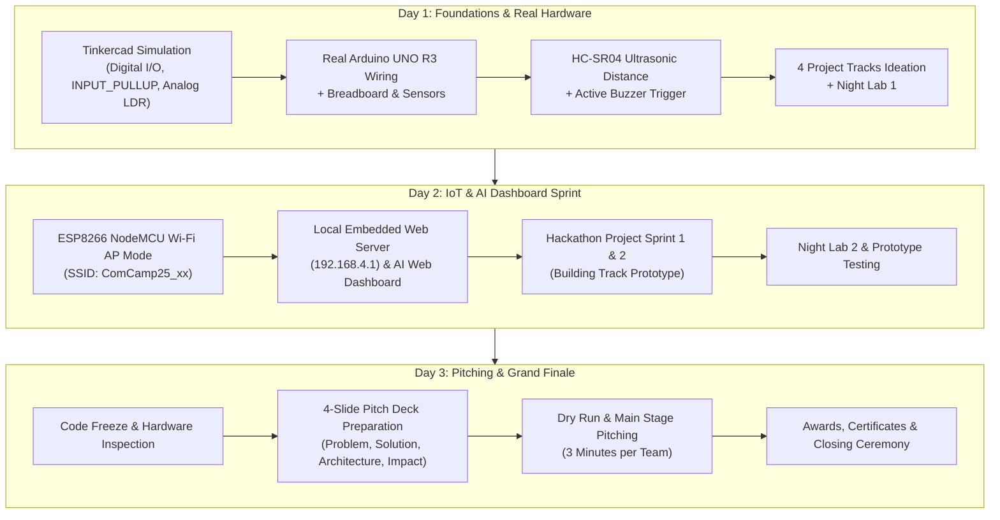

# ComCamp #25 — Project Handoff Documentation & Technical Specification
## เอกสารส่งมอบโครงการและข้อกำหนดทางเทคนิค ค่ายยุวชนคอมพิวเตอร์ ครั้งที่ 25

> **Repository:** [https://github.com/numcayX2/Comcamp-25th.git](https://github.com/numcayX2/Comcamp-25th.git)  
> **Host Organization:** สาขาวิชาวิทยาการคอมพิวเตอร์ คณะวิทยาศาสตร์ มหาวิทยาลัยแม่โจ้ (Computer Science Department, Faculty of Science, Maejo University)  
> **Last Updated (อัปเดตล่าสุด):** 9 พฤศจิกายน 2569 (2026-11-09)  
> **Target Audience:** Frontend Engineers, Go Backend Engineers, Design/Marketing Teams, Camp Organizers (พี่ค่าย)

---

## 0. Executive Summary: What We Have Done & What Is Left (สรุปความคืบหน้าและงานที่เหลือ)

### ✅ สิ่งที่ดำเนินการเสร็จสิ้นแล้ว (What We Have Done)

1. **หน้าโฮมเพจหลักโฉมใหม่ (`HomePage.astro`) พร้อมแกลเลอรี 3D Memory Tunnel (`#gallery`)**
   - นำดีไซน์หน้าโฮมเพจโทน **Warm Paper (`#F6F4EF`) + Forest (`#027F00`)** เข้าสู่โปรเจกต์จริงที่ [`frontend/src/components/HomePage.astro`](frontend/src/components/HomePage.astro), [`frontend/public/theme/styles.css`](frontend/public/theme/styles.css), [`frontend/public/theme/page.css`](frontend/public/theme/page.css) และ [`frontend/public/theme/main.js`](frontend/public/theme/main.js)
   - คงดีไซน์และแอนิเมชันของ **Memory Tunnel 3D Scroll Gallery (`#gallery`)** สำหรับเล่าเรื่องภาพความทรงจำค่ายปีที่แล้วทั้ง 43 รูป (`g01.jpg`–`g43.jpg`) ไว้ 100% ตามต้นฉบับ พร้อมฉากจบ *"แล้วพบกัน ComCamp 25"* และปุ่มลิงก์ไปยังหน้า `/status`
   - เชื่อมต่อแถบสถานะบน Hero, ตัวนับเวลาถอยหลัง และแถบ Sticky Bar บนมือถือเข้ากับ API จริง (`GET /api/settings/public`) เพื่อซิงค์เวลาจากเซิร์ฟเวอร์ (`2026-11-16T00:00:00+07:00`) และจำนวนที่นั่งคงเหลือ (`30` ที่นั่งแบบ First-Come, First-Served) พร้อมระบบ Offline Fallback อัตโนมัติ
   - คัดกรองและลบส่วนจำลองสำหรับนักพัฒนา (`#status-check`) รวมถึงข้อความกำกับภายใน (`TODO(content):`, `AGENTS.md`, `Server-Authoritative`, `SLIP_REJECTED`) ออกทั้งหมด เพื่อให้เนื้อหาทุกส่วนพร้อมสำหรับนักเรียนและผู้ปกครองใช้งานจริง

2. **ระบบฝากรูปภาพแกลเลอรีบน Cloudflare CDN พร้อม Local Fallback**
   - อัปโหลดและ Deploy รูปแกลเลอรีทั้ง 43 รูป (`g01.jpg`–`g43.jpg`) ขึ้น **Cloudflare Workers & Pages Static Assets** เรียบร้อยที่ URL:  
     `https://comcamp25-gallery.sokulshop5.workers.dev/`
   - ผูกตัวแปร `PUBLIC_GALLERY_BASE_URL` เข้ากับ [`frontend/.env`](frontend/.env), [`.env.example`](.env.example), [`HomePage.astro`](frontend/src/components/HomePage.astro) และ [`main.js`](frontend/public/theme/main.js) พร้อมระบบ `onerror` สลับกลับมาใช้ไฟล์สำรองในเครื่อง (`/assets/gallery/gXX.jpg`) อัตโนมัติหากเครือข่ายผู้ใช้งานไม่สามารถโหลดจาก CDN ได้
   - อัปเดต [`.gitignore`](.gitignore) และ [`frontend/.gitignore`](frontend/.gitignore) เพื่อยกเว้นโฟลเดอร์รูป `frontend/public/assets/gallery/`, `.commandcode/` และ `AGENTS.md` ไม่ให้ Repository บน GitHub บวม

3. **ระบบ Go Backend (`backend/`) และฐานข้อมูล PostgreSQL**
   - พัฒนาโครงสร้าง Go Clean Architecture ครบวงจร (`cmd/api`, `internal/domain`, `internal/repository/postgres`, `internal/repository/memory`, `internal/service`, `internal/handler`, `internal/middleware`) พร้อมไฟล์ SQL Migration (`migrations/000001_init_schema.up.sql`) และ OpenAPI Spec (`docs/openapi.json`)
   - รองรับทั้งโหมดเชื่อมต่อฐานข้อมูล PostgreSQL จริงและโหมด In-Memory Fallback รวมถึง Unit/Integration Tests

4. **ระบบหน้าสมัคร (`/register`), ตรวจสอบสถานะ/อัปโหลดสลิป (`/status`), และแอดมิน (`/admin`)**
   - พัฒนาและเชื่อมต่อ React Components ([`RegisterSection.tsx`](frontend/src/components/RegisterSection.tsx), [`StatusSection.tsx`](frontend/src/components/StatusSection.tsx), [`AdminSection.tsx`](frontend/src/components/AdminSection.tsx)) เข้ากับ API Contract ของ Go Backend ครบทุก Flow หลัก (ส่งใบสมัคร, ค้นหาสถานะ, ยืนยันสิทธิ์/อัปโหลดสลิป, และแอดมินตรวจสอบอนุมัติสลิป)

5. **Hero 3D, Editorial Minimalism และ GSAP Immersive Motion (อัปเดต 2026-11-09)**
   - **Hero เต็มจอ (`HeroSection.astro` + `src/scripts/hero-3d.js`):** แสดงบอร์ด ESP8266 และ Arduino UNO R3 จาก `/models/*.glb` เป็นโมเดล 3D จริงใน canvas เดียว จัดมุมเป็นรูปตัว V (ค่าอยู่ใน `HERO_3D_CONFIG`, ปรับสดในคอนโซลได้ด้วย `HERO_3D.config.<board>.rotation.x = …`) ต้อง `npm i @fontsource/pixelify-sans` ก่อน build
   - **Navbar ลอย:** `SiteNav.astro` บนหน้าแรกใช้ `.site-nav.is-home { position: fixed !important }` (ประกาศใน `<style>` ของคอมโพเนนต์เอง เพราะ scoped CSS ของ Astro ทับ `styles.css`) ทำให้ `.hero` สูง `100svh` พอดีและเริ่มที่ `y = 0`
   - **Editorial Minimalism (section 02–06 + footer):** ไฟล์ใหม่ [`frontend/public/theme/editorial.css`](frontend/public/theme/editorial.css) โหลดต่อจาก `page.css` ทุก section ใช้คลาส `ed-sec` + ป้ายเลข `.ed-index` (02 ประสบการณ์ · 03 ข้อมูล · 04 เส้นทาง · 05 ไทม์ไลน์ · 06 FAQ) จัดสองคอลัมน์ (ซ้าย sticky หัวข้อ / ขวา เนื้อหา) ใช้เส้น hairline แทนการ์ด ไม่มีเงา; **`#gallery` (Memory Tunnel) ไม่ถูกแตะ**
   - **GSAP Immersive Motion:** ฟังก์ชัน `initEditorialMotion()` ใน [`frontend/public/theme/main.js`](frontend/public/theme/main.js) (เรียกจาก `initGsap()`): progress hairline ด้านบนหน้า, hero exit (scrub), title mask-reveal, เส้นกรอบ draw ด้วย `--rule-p`, row reveal แบบ `ScrollTrigger.batch`, ตัวเลขใหญ่ mask-rise + parallax (desktop), footer reveal; ทั้งหมดอยู่ใน `gsap.matchMedia('(prefers-reduced-motion: no-preference)')` จึงไม่ทำงานเมื่อผู้ใช้ปิดแอนิเมชัน และเนื้อหาไม่ถูกซ่อนด้วย CSS (ถ้า JS/GSAP โหลดไม่ได้ก็ยังเห็นครบ)

---

### 📋 สิ่งที่ต้องดำเนินการต่อ (What We Have Left To Do)

1. **ปรับปรุง UI/UX ของหน้า `/register`, `/status`, และ `/admin` ให้เข้าธีมเดียวกับหน้าโฮมเพจใหม่ (UI Polish)**
   - ปัจจุบันหน้า `/register`, `/status` และ `/admin` ทำงานเชื่อมต่อ API ได้ครบแล้ว แต่ยังใช้ UI โครงร่าง (Skeleton Tailwind UI) สามารถปรับโฉมให้ใช้ระบบสี **Warm Paper (`#F6F4EF`) + Forest (`#027F00`)** และแบ่งฟอร์มสมัครเป็น Step ให้สอดคล้องกับหน้าโฮมเพจใหม่
2. **กำหนดพฤติกรรมเส้นทาง `/` (Root) และ `/home` ช่วงก่อนเปิดรับสมัคร**
   - ปัจจุบันทั้ง `/` ([`index.astro`](frontend/src/pages/index.astro)) และ `/home` ([`home.astro`](frontend/src/pages/home.astro)) แสดงผล `HomePage.astro` (ซึ่งมีแถบนับถอยหลังในตัวอยู่แล้ว) หากทีมงานต้องการให้ `/` แสดงหน้า `CountdownHero.tsx` (นาฬิกา Split-Flap เต็มจอ) เฉพาะช่วงก่อนวันที่ 16 พ.ย. 2569 และกดปุ่มเข้าสู่ `/home` สามารถสลับใน `index.astro` ได้ทันที
3. **เติมข้อมูลทางการของค่ายเมื่อประกาศอย่างเป็นทางการ (Official Content Fill-in)**
   - **วันที่จัดค่ายจริง (3 วัน 2 คืน)** และ **ชื่ออาคาร/ห้องปฏิบัติการ/หอพักแยกชาย-หญิง** ใน [`HomePage.astro`](frontend/src/components/HomePage.astro)
   - **เลขบัญชีธนาคารของสาขาวิชา** สำหรับขั้นตอนการโอนเงินยืนยันสิทธิ์ (ยืนยันยอดเงินแล้ว: 1,000 บาท)
   - **เบอร์โทรศัพท์อาจารย์ผู้รับผิดชอบโครงการและลิงก์เพจ Facebook ทางการ** ในส่วน Timeline และ Footer
4. **การนำขึ้นระบบจริง (Production Deployment & End-to-End QA)**
   - Commit & Push โค้ดล่าสุดขึ้น GitHub (`Comcamp-25th`)
   - Deploy ส่วน Frontend ขึ้น Cloudflare Pages (หรือ Hosting ปลายทาง) และรัน Go Backend + PostgreSQL บนเซิร์ฟเวอร์จริง พร้อมตั้งค่า `PUBLIC_API_URL`, `PUBLIC_GALLERY_BASE_URL`, `JWT_SECRET` และทดสอบการรับสมัครครบวงจร (E2E) ก่อนวันเปิดรับสมัคร **16 พฤศจิกายน 2569 เวลา 00:00:00 น.**

---

## 1. Project Overview (ภาพรวมโครงการ)

**ComCamp #25 (ค่ายยุวชนคอมพิวเตอร์ ครั้งที่ 25)** เป็นค่ายวิชาการเชิงปฏิบัติการ (Hands-on Workshop & Hackathon) ระยะเวลา **3 วัน 2 คืน** จัดโดยสาขาวิชาวิทยาการคอมพิวเตอร์ คณะวิทยาศาสตร์ มหาวิทยาลัยแม่โจ้ เพื่อเปิดโอกาสให้นักเรียนระดับมัธยมศึกษาตอนปลายและอาชีวศึกษาได้เรียนรู้การเขียนโปรแกรม การต่อวงจรฮาร์ดแวร์ไมโครคอนโทรลเลอร์ (Arduino UNO R3 & ESP8266 NodeMCU), ระบบ IoT (Internet of Things) และการสร้างหน้าเว็บ AI Dashboard ควบคุมอุปกรณ์ผ่านสมาร์ตโฟน โดยมุ่งเน้นการลงมือปฏิบัติจริงโดยไม่จำเป็นต้องมีพื้นฐานมาก่อน

---

## 2. Confirmed Camp Specifications & Tentative Items (ข้อกำหนดค่ายที่ยืนยันแล้ว และข้อมูลที่รอการยืนยัน)

*สถานะข้อมูลอ้างอิง ณ วันที่ 8 พฤศจิกายน 2569 (Status as of 2026-11-08)*

| Parameter (หัวข้อ) | Confirmed Value (ข้อมูลที่ยืนยันแล้ว) | Status / Notes (สถานะ / หมายเหตุ) |
|---|---|---|
| **Application Open Date (วันเปิดรับสมัคร)** | **16 พฤศจิกายน 2569 เวลา 00:00:00 น.** (`2026-11-16T00:00:00+07:00`) | ✅ **Confirmed** (ซิงค์ตรงกับระบบ Countdown และ API) |
| **Seat Quota (จำนวนที่เปิดรับ)** | **30 คน** (30 seats — First-Come, First-Served) | ✅ **Confirmed** |
| **Eligibility (คุณสมบัติผู้สมัคร)** | **ม.4 – ม.6** และ **ปวช.1 – ปวช.3** | ✅ **Confirmed** (ไม่จำกัดสายการเรียน ไม่จำเป็นต้องมีพื้นฐานมาก่อน) |
| **Camp Duration (ระยะเวลา)** | **3 วัน 2 คืน** (3 Days 2 Nights) | ✅ **Confirmed** |
| **Camp Event Dates (วันจัดค่ายจริง)** | `TBD` (รอประกาศวันที่จัดกิจกรรม 3 วัน 2 คืน) | ⏳ **Pending Official Confirmation** |
| **Registration Fee (ค่าใช้จ่าย)** | **1,000 บาท** (3 วัน 2 คืน รวมที่พัก อาหารทุกมื้อ และชุดอุปกรณ์บอร์ดทดลอง) | ✅ **Confirmed** |
| **Venue & Dormitory Details (อาคารเรียน/หอพัก)** | สาขาวิชาวิทยาการคอมพิวเตอร์ คณะวิทยาศาสตร์ มหาวิทยาลัยแม่โจ้ | ⏳ **Pending Specific Room & Dormitory Names** |
| **Contact Channels (ช่องทางติดต่อ)** | เพจ Facebook โครงการค่ายยุวชนคอมพิวเตอร์ / เบอร์อาจารย์ผู้รับผิดชอบ | ⏳ **Pending Phone Number & Direct Page URL** |

### 2.1 Curriculum & Schedule (หลักสูตรและการเรียนรู้ 3 วัน 2 คืน)



---

## 3. Monorepo Architecture & Route Status (สถาปัตยกรรมและสถานะหน้าเว็บ)

```
Comcamp-site/
├── .env.example              # ตัวอย่าง Environment Variables (DB, JWT, PUBLIC_API_URL, PUBLIC_GALLERY_BASE_URL)
├── .gitignore                # ยกเว้น node_modules, dist, .env, gallery local cache, AI config folders
├── docker-compose.yml        # PostgreSQL 16 Alpine container (127.0.0.1:5432)
├── HANDOFF.md                # เอกสารส่งมอบโครงการและสรุปสถานะฉบับนี้
├── backend/                  # ระบบหลังบ้าน Go Clean Architecture + PostgreSQL
│   ├── cmd/api/main.go       # Entrypoint ของ Go HTTP Server (:8000)
│   ├── docs/openapi.json     # OpenAPI 3.0 Specification
│   ├── internal/             # config, domain, handler, middleware, repository, service
│   ├── migrations/           # SQL Schema Migrations (000001_init_schema.up.sql)
│   └── README.md             # คู่มือการรันและทดสอบ Go Backend
└── frontend/                 # เว็บแอปพลิเคชัน (Astro 5 + React 19 + GSAP 3 + Tailwind)
    ├── .env                  # ตั้งค่า PUBLIC_API_URL และ PUBLIC_GALLERY_BASE_URL
    ├── .gitignore            # ยกเว้น dist, .astro, .env.*, public/assets/gallery/
    ├── public/
    │   ├── assets/
    │   │   ├── gallery/      # รูปสำรอง g01.jpg–g43.jpg ในเครื่อง (Ignored ใน Git, เสิร์ฟหลักผ่าน Cloudflare CDN)
    │   │   └── logo/         # โลโก้ค่าย ComCamp #25
    │   └── theme/
    │       ├── styles.css    # ระบบ Design Tokens (Warm Paper & Dark Memory Tunnel)
    │       ├── page.css      # สไตล์เฉพาะส่วนของหน้าโฮมเพจ
    │       └── main.js       # ระบบซิงค์สถานะเซิร์ฟเวอร์, Particle Canvas, GSAP ScrollTrigger & Memory Tunnel 3D
    └── src/
        ├── layouts/
        │   └── BaseLayout.astro      # Layout สำหรับหน้าระบบรับสมัคร/ตรวจสอบสถานะ/แอดมิน
        ├── pages/
        │   ├── index.astro           # เส้นทาง / (แสดงผล HomePage.astro)
        │   ├── home.astro            # เส้นทาง /home (แสดงผล HomePage.astro)
        │   ├── register.astro        # เส้นทาง /register (หน้าฟอร์มรับสมัคร)
        │   ├── status.astro          # เส้นทาง /status (หน้าตรวจสอบสถานะและอัปโหลดสลิป)
        │   └── admin.astro           # เส้นทาง /admin (หน้าแดชบอร์ดผู้ดูแลระบบ)
        ├── components/
        │   ├── HomePage.astro        # หน้าโฮมเพจหลัก ComCamp #25 พร้อม 3D Memory Tunnel Gallery
        │   ├── CountdownHero.tsx     # คอมโพเนนต์นับถอยหลัง Mechanical Split-Flap (สำรอง/สลับใช้ได้)
        │   ├── RegisterSection.tsx   # ฟอร์มรับสมัครพร้อม Client Validation เชื่อมต่อ Go Backend
        │   ├── StatusSection.tsx     # ระบบค้นหาสถานะใบสมัคร ยืนยันสิทธิ์ และอัปโหลดสลิปโอนเงิน
        │   └── AdminSection.tsx      # แดชบอร์ดแอดมิน ตรวจสลิปและจัดการสถานะผู้สมัคร
        └── lib/
            └── api.ts                # Shared API client + Offline Fallback + Server Time Sync
```

### 3.1 Route Status Overview (สถานะปัจจุบันของแต่ละเส้นทาง)

| Route | Main Files | Description | Current Status |
|---|---|---|---|
| **`/`** และ **`/home`** | `src/pages/index.astro`<br/>`src/pages/home.astro`<br/>`src/components/HomePage.astro`<br/>`public/theme/*` | **Flagship Homepage & 3D Memory Tunnel Gallery**<br/>หน้าประชาสัมพันธ์ค่ายหลักโฉมใหม่ พร้อมแถบ Countdown & สถานะที่นั่งจากเซิร์ฟเวอร์, การ์ดกิจกรรม 4 ด้าน, Bento ข้อมูลสำคัญ, เส้นทางการเรียนรู้ 3 วัน 2 คืน, FAQ และแกลเลอรี 3D Memory Tunnel 43 รูปจาก Cloudflare CDN | 🟢 **Production-Ready** (ผ่านการคัดกรองเนื้อหาจริง และผูก Cloudflare CDN + Local Fallback แล้ว) |
| **`/register`** | `src/pages/register.astro`<br/>`RegisterSection.tsx` | **Registration Flow**<br/>แบบฟอร์มกรอกข้อมูลผู้สมัคร เชื่อมโยงกับ `POST /api/applications` | 🟡 **Functionally Complete / UI Polish Optional** (ทำงานร่วมกับ Backend ได้ครบ รอปรับธีมสีให้เข้ากับโฮมเพจใหม่หากต้องการ) |
| **`/status`** | `src/pages/status.astro`<br/>`StatusSection.tsx` | **Application Status & Slip Upload**<br/>ค้นหาใบสมัครด้วยเลขบัตรประชาชน/เบอร์โทร/รหัสใบสมัคร (`CC25-XXXXXX`), กดยืนยันสิทธิ์ และอัปโหลดสลิปโอนเงิน | 🟡 **Functionally Complete / UI Polish Optional** (ทำงานร่วมกับ Backend ได้ครบ รอปรับธีมสีให้เข้ากับโฮมเพจใหม่หากต้องการ) |
| **`/admin`** | `src/pages/admin.astro`<br/>`AdminSection.tsx` | **Admin Dashboard**<br/>หน้าสำหรับพี่ค่าย เข้าสู่ระบบด้วย JWT, ดูตารางผู้สมัคร, ตรวจรูปสลิปโอนเงิน และอนุมัติสถานะใบสมัคร | 🟡 **Functionally Complete / UI Polish Optional** |

---

## 4. Cloudflare CDN Gallery Configuration (การตั้งค่ารูปภาพบน Cloudflare CDN)

รูปภาพบรรยากาศค่ายปีที่แล้วทั้ง 43 รูป (`g01.jpg` – `g43.jpg`) ถูกอัปโหลดขึ้น **Cloudflare Workers & Pages** เรียบร้อยแล้ว เพื่อลดภาระแบนด์วิดท์ของเซิร์ฟเวอร์หลักและให้โหลดผ่าน Edge CDN ในไทยได้อย่างรวดเร็ว:

- **Production CDN Base URL:** `https://comcamp25-gallery.sokulshop5.workers.dev/`
- **Environment Variable (`frontend/.env`):**
  ```env
  PUBLIC_API_URL=http://localhost:8000/api
  PUBLIC_GALLERY_BASE_URL=https://comcamp25-gallery.sokulshop5.workers.dev/
  ```
- **กลไก Fallback อัตโนมัติ:**
  หากรูปใดจาก `PUBLIC_GALLERY_BASE_URL` โหลดไม่สำเร็จ ระบบใน `public/theme/main.js` จะสลับไปดึงรูปจาก `/assets/gallery/gXX.jpg` ให้อัตโนมัติทันทีโดยไม่ทำให้หน้าเว็บหรือแอนิเมชัน 3D Tunnel เสียหาย

---

## 5. Local Setup & Verification Guide (คู่มือการรันและตรวจสอบระบบ)

### 5.1 การรัน Frontend (Astro)
```bash
cd frontend
npm install
npm run dev
```
ทดสอบการ Build สำหรับ Production:
```bash
cd frontend
npm run build
```

### 5.2 การรันฐานข้อมูล PostgreSQL และ Go Backend
```bash
# 1. รันฐานข้อมูล PostgreSQL ผ่าน Docker
docker compose up -d db

# 2. รัน Go Backend API Server (พอร์ต 8000)
cd backend
go run ./cmd/api
```

---

*เอกสารฉบับนี้อัปเดตสถานะล่าสุดเมื่อวันที่ 8 พฤศจิกายน 2569 เพื่อให้ทีมพัฒนาและผู้จัดกิจกรรม ComCamp #25 เห็นภาพรวมสิ่งที่ทำเสร็จแล้วและสิ่งที่ต้องดำเนินการต่ออย่างชัดเจน*
