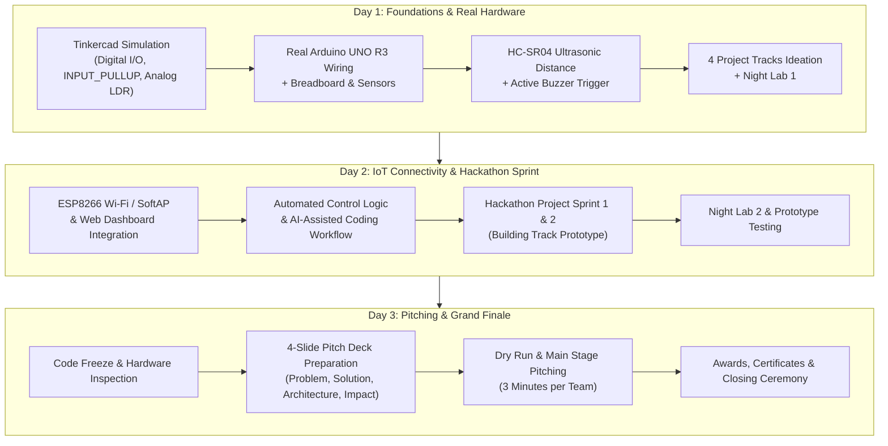

# ComCamp #25 — Project Handoff Documentation & Technical Specification
## เอกสารส่งมอบโครงการและข้อกำหนดทางเทคนิค ค่ายยุวชนคอมพิวเตอร์ ครั้งที่ 25

> **Repository:** [https://github.com/numcayX2/Comcamp-25th.git](https://github.com/numcayX2/Comcamp-25th.git)  
> **Host Organization:** สาขาวิชาวิทยาการคอมพิวเตอร์ คณะวิทยาศาสตร์ มหาวิทยาลัยแม่โจ้ (Computer Science Department, Faculty of Science, Maejo University)  
> **Last Updated (อัปเดตล่าสุด):** 17 พฤศจิกายน 2569 (2026-11-17 · อัปเดตให้ตรงโค้ดจริงหลังนำ `ESP8266` 3D และ IoT Dashboard กลับมา)  
> **Target Audience:** Frontend Engineers, Go Backend Engineers, Design/Marketing Teams, Camp Organizers (พี่ค่าย)

---

## 0. Executive Summary: What We Have Done & What Is Left (สรุปความคืบหน้าและงานที่เหลือ)

> **สถานะล่าสุด ณ `2026-11-17`:** ฟีเจอร์ฝั่งแอปพลิเคชันและฐานข้อมูล **พร้อมสำหรับการเปิดรับสมัครครบทั้งระบบแล้ว** ทั้งกำหนดการใหม่ (`18 พ.ย.–18 ธ.ค. 2569`), วันจัดค่าย (`5–7 ก.พ. 2570`), ค่าสมัคร (`1,200 บาท` พร้อมรายการสิทธิประโยชน์ครบ 7 อย่าง), ข้อมูลหอพัก (`เรือนพักสมาคมศิษย์เก่าแม่โจ้`), อาจารย์ผู้รับผิดชอบ (`ดร.ปวีณ เขื่อนแก้ว`), เบอร์ติดต่อพี่ค่าย, อีเมลแจ้งเตือน 2 ขั้นตอนผ่าน SMTP (`mailer.go`), การคืนที่นั่งอัตโนมัติเกิน 72 ชม. (+ 24 ชม. grace window), คอร์ส **Microcontroller (`Arduino UNO R3` & `ESP8266`) with IoT & AI Dashboard**, และข้อความ `เลขบัตรประจำตัว 13 หลัก` ที่รองรับทั้ง **บัตรประชาชน** และ **บัตรชมพู**  
> เป้าหมาย deploy จริงคือ **rootless Docker ที่พอร์ต 6000** บน `202.28.37.1` โดเมนทดสอบ `https://comcampdev.csmju.com` — รายละเอียดอยู่ใน [`deploy/FACULTY-ROOTLESS.md`](deploy/FACULTY-ROOTLESS.md)

### ✅ สิ่งที่ดำเนินการเสร็จสิ้นแล้ว (COMPLETED)

1. **หน้าโฮมเพจ Flagship (`HomePage.astro`, `HeroSection.astro`, `SiteNav.astro`, `public/theme/*`)**
   - **Hero 3D (`HeroSection.astro` + `src/scripts/hero-3d.js`):** แสดงบอร์ดคู่ **Arduino UNO R3 + ESP8266** ([`ArduinoR3.glb`](frontend/public/models/ArduinoR3.glb) และ [`esp8266.glb`](frontend/public/models/esp8266.glb)) ใน WebGL canvas (`HERO_3D_CONFIG`) พร้อม self-hosted Draco decoder ([`frontend/public/draco/gltf/`](frontend/public/draco/gltf/draco_decoder.js)), `fitRig()` auto-framing, mouse parallax, drag/touch-to-rotate, keyboard arrow rotation, `IntersectionObserver` หยุด render เมื่อเลื่อนพ้นจอ และ `prefers-reduced-motion` static fallback
   - **Hero Typography, Animations & Zero-CLS:** หัวข้อ `Comcamp 25th` ใช้ **`@fontsource/space-grotesk` (`700`)** พร้อม **ScrambleText** animation และคำบรรยาย `.hero__sub` ใช้ **GSAP `SplitText`** เลื่อนเข้าจากขวาไปซ้าย หลัง `document.fonts.ready`; โลโก้ใช้ `<picture>` เสิร์ฟ WebP ([`comcamp25-logo-sm.webp`](frontend/public/assets/logo/comcamp25-logo-sm.webp)) พร้อม PNG fallback; preloads `.woff2` 5 ไฟล์, defer การโหลด `hero-3d.js` หลัง `load` + `requestIdleCallback`, ล็อกขนาด `.hero__copy` / `.hero__stage-wrap` กัน CLS, และ pre-paint `.veil` bypass (`veil-skip`)
   - **Navbar & Mobile ToC Drawer (`SiteNav.astro` + `main.js`):**
     - บนหน้าแรกใช้ `.site-nav.is-home { position: fixed !important }` สูง `100svh` ที่ `y = 0` และเลื่อนหลบอัตโนมัติเมื่อเข้า `#gallery`
     - ปุ่ม CTA ทรง **Full Pill (`border-radius: 9999px`)**, Light/Dark Mode (`comcamp-theme`), ลิงก์หมวด `02`–`07` (`#experience`, `#essentials`, `#journey`, `#timeline`, `#faq`, `#gallery`) พร้อม scroll-spy (`aria-current="true"`), Mobile ToC Drawer (`syncInert`, `Esc`, `#sticky-cta`), และปุ่มลอย [`BackToTop.astro`](frontend/src/components/BackToTop.astro) (`< 768px`)
   - **Pre-Open `/register` Gating & Dynamic Schedule:** ซิงค์ `GET /api/settings/public` (รวม `registrationCloseAt` และ `campFee`) ผ่าน shared 1.5 วินาที burst cache ([`public-settings-cache.ts`](frontend/src/lib/public-settings-cache.ts)), ซ่อน `[data-register-link]` ก่อนเปิดรับสมัครจริง (`18 พ.ย. 2569 00:00 น.`) และซิงค์จำนวนที่นั่ง/ค่าสมัคร/สถานะเปิดรับอัตโนมัติ (`PRE_OPEN` / `OPEN` / `ALMOST_FULL` / `FULL` / `CLOSED`)
   - **ข้อมูลทางการบนหน้าแรก (`HomePage.astro`, `editorial.css`):**
     - ใช้โทน **Warm Alabaster** (`--canvas-0` / `--canvas-1` และ `--amber-text: #9A4608` Light Mode / `#F5A524` Dark Mode)
     - **Sections `02`–`06` + `#gallery` + Footer:** ใส่ข้อมูลทางการครบแล้ว ได้แก่ วันจัดค่าย **`5–7 กุมภาพันธ์ 2570` (3 วัน 2 คืน)**, กำหนดเปิด-ปิด **`18 พ.ย.–18 ธ.ค. 2569` (เต็ม 30 ที่นั่งปิดก่อนทันที)**, ค่าสมัคร **`1,200 บาท`** (รวมที่พัก 2 คืน ณ **เรือนพักสมาคมศิษย์เก่าแม่โจ้**, อาหารหลัก 6 มื้อ, เบรก 5 มื้อ, เสื้อค่าย `SSS–4XL`, กระเป๋าพร้อมปั๊มลาย, เอกสารอบรม, เกียรติบัตร), สิ่งที่ต้องเตรียมมาค่าย (3 หมวด รวม `บัตรประจำตัว (บัตรประชาชน / บัตรชมพู) หรือบัตรประจำตัวนักเรียน`), ชื่ออาจารย์ผู้รับผิดชอบ (**`ดร.ปวีณ เขื่อนแก้ว`**) และเบอร์ติดต่อพี่ค่าย (**`080-993-8214`** / **`063-784-4515`**)

2. **ระบบฝากรูปภาพแกลเลอรีบน Cloudflare CDN พร้อม Local Fallback**
   - Deploy รูปแกลเลอรีทั้ง 43 รูป (`g01.jpg`–`g43.jpg`) ขึ้น **Cloudflare Workers Static Assets** (`https://comcamp25-gallery.sokulshop5.workers.dev/`) พร้อม `PUBLIC_GALLERY_BASE_URL` และ `onerror` สลับไปไฟล์สำรองในเครื่อง (`/assets/gallery/gXX.jpg`) อัตโนมัติ

3. **ระบบรับสมัคร (`/register`), ตรวจสอบสถานะ/สลิป (`/status`) และแอดมิน (`/admin`)**
   - **`/register` ([`RegisterSection.tsx`](frontend/src/components/RegisterSection.tsx) + [`register/`](frontend/src/components/register/model.ts)):**
     - **Step 01 Safety Box:** กล่องสรุปข้อกำหนดสำคัญ 4 ข้อเหนือฟอร์ม (วันจัดค่าย `5–7 ก.พ. 2570`, โควตา 30 ที่นั่ง เต็มก่อนปิดก่อน `18 ธ.ค. 2569`, โอนภายใน `3 วัน` เกินกำหนดคืนที่นั่งอัตโนมัติ, โอนแล้วสละสิทธิ์ไม่คืนเงินทุกกรณี)
     - **ข้อมูลผู้สมัคร & ผู้ปกครอง:** บังคับกรอก `email`, ช่อง `เลขบัตรประจำตัว 13 หลัก` พร้อมคำแนะนำ *"ใช้ได้ทั้งบัตรประชาชนและบัตรชมพู (คนไม่มีสัญชาติไทย)"* (ตรวจ Mod-11), ช่อง **ผู้ปกครอง (`parentName`, `parentRelation`, `parentPhone`)**, ไซส์เสื้อ **`SSS–4XL`** ตามตาราง `IDO IDEA`, ช่อง **`allergies`** พร้อมปุ่มเลือกด่วน (`DIETARY_QUICK_OPTIONS` เช่น `ไม่ทานหมู`, `อาหารฮาลาล (อิสลาม)`, `มังสวิรัติ` ฯลฯ) และ `medicalConditions` (`<= 500` ตัวอักษร)
     - **ความปลอดภัย & ส่งใบสมัคร:** Pre-Open Gate + Midnight Zero Jitter (`200–2000ms`), `X-Idempotency-Key` UUID v4, Cloudflare Turnstile explicit render ([`TurnstileField.tsx`](frontend/src/components/register/TurnstileField.tsx)), PDPA-safe `sessionStorage` draft allowlist ([`storage.ts`](frontend/src/components/register/storage.ts)), และ synchronous `useRef` submit lock
     - **Step 06 Receipt & Instant Slip ([`Receipt.tsx`](frontend/src/components/register/Receipt.tsx), [`SlipBlock.tsx`](frontend/src/components/register/SlipBlock.tsx)):** แสดงเลขบัญชี `587-0-84106-0` (ไม่มี QR/PromptPay), กำหนดโอน 72 ชม., นโยบายไม่คืนเงิน, **อัปโหลดสลิปได้ทันทีหลังสมัครโดยไม่ต้องกรอกเลข 4 ตัวท้ายซ้ำ** (ส่ง `verifyCode` จากหน่วยความจำ), และแสดง **QR Code + ปุ่มเข้ากลุ่ม LINE OpenChat ทันที** หลังส่งสลิป ([`line-openchat-qr.jpg`](frontend/public/assets/line-openchat-qr.jpg))
   - **`/status` ([`StatusSection.tsx`](frontend/src/components/StatusSection.tsx) + [`slip/`](frontend/src/components/slip/SlipUploadPanel.tsx) + [`status.css`](frontend/src/styles/status.css)):**
     - ค้นหา In-App Browser Safe (`เลขบัตรประจำตัว 13 หลัก` / `เบอร์โทร` / `CC25-XXXXXX`), mobile hairline layout, แสดง countdown กำหนดโอน 72 ชม., ยืนยันตัวตนด้วย **เลข 4 ตัวท้ายของบัตรประจำตัว 13 หลัก** ([`VerifyCodeField.tsx`](frontend/src/components/slip/VerifyCodeField.tsx) เฉพาะบน `/status`), แสดงหมายเหตุจากพี่ค่ายเมื่อสลิปถูกปฏิเสธ (`adminNote`) พร้อมส่งสลิปใหม่ได้ (บีบอัด WebP/JPEG `<=1600px`, ตัด EXIF), `SlipLightbox` (`100%/150%/200%`), แสดง QR/ปุ่ม LINE OpenChat หลังส่งสลิป, แก้ไขข้อมูลทั่วไป (`PATCH /api/applications/:id/profile`), และยกเลิกใบสมัครเอง (`POST /api/applications/:id/withdraw`)
   - **`/admin` ([`AdminSection.tsx`](frontend/src/components/AdminSection.tsx), [`AdminSettingsPanel.tsx`](frontend/src/components/AdminSettingsPanel.tsx), [`AdminProfileEditor.tsx`](frontend/src/components/AdminProfileEditor.tsx)):**
     - JWT Auth (`sessionStorage`, 8 ชม.) เฉพาะบทบาทเดียว `'admin'`, ตารางข้อมูล 6 คอลัมน์, Filter tabs + Search + Sort (`newest`, `slip_queue`, `updated_desc`)
     - **Slip Approval / Re-Verify / 2-step Reject:** อนุมัติ 1 คลิก (`PASSED -> CONFIRMED`), รองรับการตรวจซ้ำเมื่อเปลี่ยนคำตัดสิน (`APPROVED <-> REJECTED`), ปฏิเสธสลิปมีขั้นยืนยันที่ 2 + บังคับกรอกหมายเหตุ, ผูก `paymentId` (`X-Slip-Payment-Id`) กัน `409 SLIP_CHANGED`, Authorized Blob + `SlipLightbox`
     - ดู/แก้ไขข้อมูลเต็มรวมผู้ปกครองและ `allergies`/`medicalConditions` (`AdminProfileEditor`), ปรับค่าค่าย/กำหนดการ/โควตา/ปิดรับฉุกเฉิน (`AdminSettingsPanel`), ส่งออก CSV (`UTF-8 BOM` + `RFC 4180` + formula escaping + `export-audit`), และ `useRef` double-submit locks บนทุกปุ่ม

4. **ระบบ Go Backend (`backend/`), Migrations `000001–000010`, SMTP Async Mailer & Production Deploy**
   - Go `1.27.3` Clean Architecture พร้อม **10 คู่ SQL Migrations (`000001`–`000010`)** ใน [`backend/migrations/`](backend/migrations/) (`000008` กำหนดการ `18 พ.ย.–18 ธ.ค.`, `000009` ไซส์เสื้อ `SSS–4XL` + `XS`, `000010` ค่าสมัคร `1,200.00` บาท) และ OpenAPI Spec ([`backend/docs/openapi.json`](backend/docs/openapi.json))
   - **72h Unpaid Auto-Expiry + 24h Grace (`applicant_service.go`, `cmd/api/main.go`):** งานเบื้องหลังตรวจใบสมัคร `PASSED` ที่ค้างเกิน 72 ชม. และยังไม่ส่งสลิป (`ExpireOverdueUnpaid`) ปรับเป็น `REJECTED` อัตโนมัติพร้อมคืนที่นั่ง (มี **grace window `24h`** จาก `updated_at`/หลังถูกปฏิเสธสลิปหรือแอดมินคืนสิทธิ์ เพื่อไม่ให้ถูกตัดสิทธิ์ซ้ำทันที)
   - **2-Stage Async SMTP Mailer ([`mailer.go`](backend/internal/service/mailer.go) + [`mailer_test.go`](backend/internal/service/mailer_test.go)):** ส่งอีเมลแจ้งรับใบสมัคร + รายละเอียดการโอน (`POST /api/applications`) และส่งอีเมลยืนยันสิทธิ์สมบูรณ์ + Google Maps เรือนพัก + ลิงก์ LINE OpenChat เมื่ออนุมัติเป็น `CONFIRMED` (พร้อม `AttendanceConfirmed = true`) ด้วย `net/smtp` STARTTLS + RFC 5322 `Date` / `Message-ID` / `quoted-printable`
   - **Security & Faculty Deploy:** ผ่าน pentest fixes (F-01..F-04), `TestSecurity_TwoAdmins_TokenCannotImpersonate` ([`rbac_test.go`](backend/internal/handler/rbac_test.go)), security headers, และคู่มือ deploy แบบ Rootless Docker บนเซิร์ฟเวอร์ภาควิชา ([`deploy/FACULTY-ROOTLESS.md`](deploy/FACULTY-ROOTLESS.md), [`deploy/RUNBOOK.md`](deploy/RUNBOOK.md), [`docker-compose.prod.yml`](docker-compose.prod.yml))

---

### 📋 สิ่งที่ต้องดำเนินการต่อก่อน Go-Live (PENDING — รอเฉพาะขั้นตอน Push, Infra & Production Secrets)

1. **ซิงค์โค้ดขึ้น Remote (`origin/main`):**
   - Push commit ล่าสุดบน `main` (`74b8d3d`, `906aff0`, `e2f92b2` และ commit อัปเดตเอกสารนี้) ขึ้น `origin/main` ก่อนสั่ง `git clone` / `git pull` บนเซิร์ฟเวอร์จริง
2. **ข้อมูลเสริมหน้างาน (Optional — ไม่บล็อกการเปิดรับสมัคร):**
   - เลขห้องปฏิบัติการ / ชื่ออาคารเรียนเฉพาะบนเว็บไซต์ (ปัจจุบันระบุสาขาวิชาวิทยาการคอมพิวเตอร์ คณะวิทยาศาสตร์ ม.แม่โจ้ — ดูหมายเหตุใน [`deploy/FACULTY-ROOTLESS.md`](deploy/FACULTY-ROOTLESS.md))
   - *(หมายเหตุโค้ดเล็กน้อย)* หัวคอลัมน์ CSV export ใน [`applicant-tools.ts`](frontend/src/lib/applicant-tools.ts#L84) ปัจจุบันยังเป็น `'เลขประจำตัวประชาชน'` สามารถปรับเป็น `'เลขบัตรประจำตัว 13 หลัก'` เพิ่มเติมได้หากต้องการให้ตรงทุกที่
3. **การนำขึ้นเซิร์ฟเวอร์จริง (Faculty Rootless Docker @ `202.28.37.1:6000`):**
   - ปิดเงื่อนไข Round 2 ตาม [`deploy/FACULTY-ROOTLESS.md`](deploy/FACULTY-ROOTLESS.md): ยืนยัน routing พอร์ต `6000` / TLS proxy, ใส่ Cloudflare **Turnstile keys จริง** ของโดเมนที่ใช้งาน (เช่น `comcampdev.csmju.com`), ใส่ค่า **`SMTP_*` (SMTP-only App Password)** จริงใน `.env.prod`
   - รัน `docker compose -f docker-compose.prod.yml --env-file .env.prod up -d --build`, สร้างบัญชีแอดมินจริงด้วย `/app/create-admin` และทดสอบ End-to-End QA (สมัคร → อีเมลขั้น 1 → ส่งสลิป → `/admin` อนุมัติ → อีเมลขั้น 2) ก่อนเปิดรับสมัคร **`18 พฤศจิกายน 2569 เวลา 00:00:00 น.`**

---

## 1. Project Overview (ภาพรวมโครงการ)

**ComCamp #25 (ค่ายยุวชนคอมพิวเตอร์ ครั้งที่ 25)** เป็นค่ายวิชาการเชิงปฏิบัติการ (Hands-on Workshop & Hackathon) ระยะเวลา **3 วัน 2 คืน** จัดโดยสาขาวิชาวิทยาการคอมพิวเตอร์ คณะวิทยาศาสตร์ มหาวิทยาลัยแม่โจ้ เพื่อเปิดโอกาสให้นักเรียนระดับมัธยมศึกษาตอนปลายและอาชีวศึกษาได้เรียนรู้การเขียนโปรแกรม การต่อวงจรฮาร์ดแวร์ไมโครคอนโทรลเลอร์ (**Arduino UNO R3 & ESP8266**) การเชื่อมต่อระบบ **IoT & AI Dashboard** และการพัฒนาโครงงานระบบอัตโนมัติเชิงปฏิบัติการ โดยมุ่งเน้นการลงมือปฏิบัติจริงโดยไม่จำเป็นต้องมีพื้นฐานมาก่อน

*(ดูเอกสารสถาปัตยกรรมระบบร่วมฉบับเต็มได้ที่ [`ComCamp.md`](ComCamp.md) และมาตรฐานวิศวกรรม Frontend/Security ได้ที่ [`AGENTS.md`](AGENTS.md))*

---

## 2. Confirmed Camp Specifications & Status (ข้อกำหนดค่ายที่ยืนยันแล้ว และข้อมูลเพิ่มเติม)

*สถานะข้อมูลตรงตามโค้ดจริง ณ วันที่ 17 พฤศจิกายน 2569 (Status as of `2026-11-17` — commit `e2f92b2`)*

| Parameter (หัวข้อ) | Confirmed Value (ข้อมูลที่ยืนยันแล้ว) | Status / Notes (สถานะ / หมายเหตุ) |
|---|---|---|
| **Application Open Date (วันเปิดรับสมัคร)** | **18 พฤศจิกายน 2569 เวลา 00:00:00 น.** (`2026-11-18T00:00:00+07:00`) | ✅ **Confirmed & Implemented** *(Migration `000008` + UI/Countdown)* |
| **Application Close Date (วันปิดรับสมัคร)** | **18 ธันวาคม 2569** (`2026-12-18T23:59:59+07:00`, **เต็มก่อนปิดก่อน**) | ✅ **Confirmed & Implemented** *(ปรับแก้ได้ใน `/admin`)* |
| **Seat Quota (จำนวนที่เปิดรับ)** | **30 คน** (30 seats — First-Come, First-Served) | ✅ **Confirmed & Implemented** *(ปรับแก้ได้ใน `/admin`)* |
| **Eligibility (คุณสมบัติผู้สมัคร)** | **ม.4 – ม.6** และ **ปวช.1 – ปวช.3** | ✅ **Confirmed & Implemented** *(ไม่จำกัดสายการเรียน ไม่จำเป็นต้องมีพื้นฐานมาก่อน)* |
| **Identity Card Support (เลขบัตรประจำตัว 13 หลัก)** | รองรับทั้ง **บัตรประชาชน** และ **บัตรชมพู (คนไม่มีสัญชาติไทย)** (ตรวจ Mod-11) | ✅ **Confirmed & Implemented** *(`/register`, `/status`, `/admin`, หน้าแรก, อีเมล)* |
| **Camp Duration & Dates (ระยะเวลา / วันจัดค่ายจริง)** | **3 วัน 2 คืน — วันที่ 5, 6, 7 กุมภาพันธ์ 2570** (`5–7 Feb 2027`) | ✅ **Confirmed & Implemented** *(แสดงบนหน้าเว็บ ใบตอบรับ และอีเมล)* |
| **Payment & Refund Policy (กำหนดโอน / คืนเงิน)** | **โอนภายใน 3 วัน (72 ชม.) หลังสมัคร** (เกินกำหนดคืนที่นั่งอัตโนมัติ, มี grace `24h` หลังถูกปฏิเสธ/คืนสิทธิ์) · **โอนแล้วสละสิทธิ์ไม่คืนเงินทุกกรณี** | ✅ **Confirmed & Implemented** *(`ExpireOverdueUnpaid` + ใบตอบรับ + `/status` + อีเมล)* |
| **Registration Fee & Bank (ค่าสมัครและบัญชีโอน)** | **1,200 บาท** (รวมที่พัก 2 คืน, อาหารหลัก 6 มื้อ, เบรก 5 มื้อ, เสื้อค่าย, กระเป๋าพร้อมปั๊มลาย, เอกสารอบรม, เกียรติบัตร) · โอนเลขบัญชี ธ.กรุงเทพ `587-0-84106-0` ชื่อบัญชี `ชมรมคอมพิวเตอร์ (นายภานุวัฒน์ นายอรรถวิท นายปวีณ)` (ไม่มี QR Code) | ✅ **Confirmed & Implemented** *(Migration `000010` + [`payment.ts`](frontend/src/lib/payment.ts))* |
| **Camp Shirt (เสื้อค่าย)** | ไซส์ **`SSS`, `SS`, `S`, `M`, `L`, `XL`, `2XL`, `3XL`, `4XL`** ตามตาราง `IDO IDEA` | ✅ **Confirmed & Implemented** *(Migration `000009` + [`SizeChips.tsx`](frontend/src/components/register/SizeChips.tsx); DB คง `XS` เพื่อความเข้ากันได้ย้อนหลัง)* |
| **Food / Dietary & Health Notes** | ฟิลด์ `allergies` พร้อมปุ่มเลือกด่วน (`ไม่ทานหมู`, `อาหารฮาลาล (อิสลาม)`, `มังสวิรัติ` ฯลฯ) และ `medicalConditions` | ✅ **Confirmed & Implemented** *(UI + DB + `/admin` + CSV export)* |
| **Parent Contact (ผู้ปกครอง 1 คน + เบอร์โทร)** | ฟิลด์ `parentName`, `parentRelation`, `parentPhone` | ✅ **Confirmed & Implemented** *(UI + Go API + PostgreSQL + `/admin` + CSV export)* |
| **Venue & Dormitory (สถานที่และหอพัก)** | สาขาวิชาวิทยาการคอมพิวเตอร์ คณะวิทยาศาสตร์ ม.แม่โจ้ · หอพัก **เรือนพักสมาคมศิษย์เก่าแม่โจ้ (แยกโซนชาย-หญิง)** พร้อมลิงก์ Google Maps | ✅ **Dorm & Maps Implemented** *(เลขห้องแล็บเฉพาะสามารถเพิ่มเติมได้หน้างาน)* |
| **Contact Channels & Advisor (ช่องทางติดต่อ)** | อาจารย์ผู้รับผิดชอบ: **ดร.ปวีณ เขื่อนแก้ว** · พี่ค่าย: **`080-993-8214`** (นายบูรพา มหัทธีรนางกูร) / **`063-784-4515`** (นางสาวธมล นวลหมวก) · Facebook (`CCCSMJU`) · **LINE OpenChat QR & Link** | ✅ **Confirmed & Implemented** *(แสดง QR/ปุ่ม LINE OpenChat ทันทีหลังส่งสลิป + ในอีเมล)* |

### 2.1 Curriculum & Schedule (หลักสูตรและการเรียนรู้ 3 วัน 2 คืน)



---

## 3. Monorepo Architecture, Tech Stack & Route Status (สถาปัตยกรรมและสถานะหน้าเว็บ)

### 3.1 Verified Dependency Versions (`frontend/package.json` & `backend/go.mod`)

- **Frontend Runtime & Core:** Node.js `>=22.23.4`, **Astro `^7.4.4`**, **React `^19.3.1`** (`@astrojs/react: ^7.1.2`), **Tailwind CSS v4 (`^4.3.3` + `@tailwindcss/vite: ^4.3.3`)**, **TypeScript `^7.0.2`**
- **Frontend Motion, 3D & Icons:** **GSAP `^3.15.1`** (bundle `gsap/SplitText` สำหรับ Hero และ `SizeChips.tsx` + CDN GSAP/ScrollTrigger `3.12.5` พร้อม SRI ใน `HomePage.astro` สำหรับ `main.js`), **Three.js `^0.187.0`**, **Lucide React `^1.66.0`**
- **Self-Hosted Fonts (`frontend/src/styles/fonts.css` & `HeroSection.astro`):** `@fontsource/ibm-plex-sans-thai` (`^5.3.0`), `@fontsource/ibm-plex-mono` (`^5.3.0`), **`@fontsource/space-grotesk` (`^5.3.0`, weight `700` สำหรับ Hero title)**
- **Backend (`backend/go.mod`):** **Go `1.27.3`**, `go-chi/chi/v5 v5.5.0`, `go-chi/cors v1.2.2`, `golang-jwt/jwt/v5 v5.3.1`, `google/uuid v1.6.0`, `jackc/pgx/v5 v5.12.0`, `joho/godotenv v1.5.1`, `shopspring/decimal v1.6.0`, `golang.org/x/crypto v0.58.0`

### 3.2 Directory Tree (ตรงตาม Repository ปัจจุบัน)

```text
Comcamp-site/
├── .env.example                    # ตัวอย่าง Env พัฒนาบนเครื่อง (DB, JWT, Turnstile, PUBLIC_*)
├── .env.prod.example               # ตัวอย่าง Env Production (ต้องตั้งรหัสลับจริงก่อน deploy)
├── .gitattributes                  # บังคับ LF สำหรับ .sh, .conf, .sql, .yml, Dockerfile, _headers
├── .gitignore                      # ยกเว้น .env, node_modules, dist, uploads, gallery local cache, AGENTS.md
├── AI_SETUP.md                     # คู่มือให้ AI Agent ช่วยเซตอัพและตรวจระบบ (โหมด A In-Memory / โหมด B Docker)
├── AGENTS.md                       # กฎวิศวกรรม Frontend/Security (Ignored ใน Git)
├── ComCamp.md                      # System Specification ฉบับรวม (v3.0)
├── HANDOFF.md                      # เอกสารส่งมอบโครงการฉบับนี้
├── README.md                       # คู่มือภาพรวมและการเริ่มต้นใช้งาน
├── docker-compose.yml              # PostgreSQL 16 Alpine สำหรับพัฒนาบนเครื่อง (127.0.0.1:5432)
├── docker-compose.prod.yml         # Production stack: db + backend + frontend + edge-proxy (internal nets)
├── deploy/
│   ├── FACULTY-ROOTLESS.md         # คู่มือ deploy Rootless Docker บนเซิร์ฟเวอร์ภาควิชา (port 6000)
│   ├── RUNBOOK.md                  # คู่มือติดตั้ง/สำรองข้อมูล/กู้คืนบนเซิร์ฟเวอร์ภาควิชา
│   ├── nginx/edge.conf             # Reverse proxy ภายใน (บล็อก /swagger /docs, ส่งต่อ /api และ /)
│   └── postgres-init/
│       └── 01-run-up-migrations.sh # รัน SQL migrations 000001–000010 อัตโนมัติเมื่อ init DB ครั้งแรก
├── backend/                        # ระบบหลังบ้าน Go 1.27.3 Clean Architecture + PostgreSQL 16
│   ├── Dockerfile                  # Multi-stage static Go build + non-root runtime (UID 10001)
│   ├── go.mod / go.sum
│   ├── README.md                   # คู่มือ API Screen Mapping, Security และ Benchmarks
│   ├── cmd/
│   │   ├── api/main.go             # Entrypoint ของ Go HTTP Server (:8000, background expiry sweep & mailer)
│   │   └── create-admin/main.go    # CLI สร้าง/รีเซ็ตบัญชีแอดมิน (bcrypt, role 'admin' เท่านั้น)
│   ├── docs/openapi.json           # OpenAPI 3.0.3 Specification
│   ├── internal/                   # config, docs, domain, handler (rbac_test.go), middleware, pkg/response, repository, server, service (mailer.go, applicant_service.go)
│   └── migrations/                 # 10 คู่ SQL Schema Migrations (000001–000010, .up.sql / .down.sql)
│       ├── 000001_init_schema.{up,down}.sql
│       ├── 000002_security_hardening.{up,down}.sql
│       ├── 000003_soft_delete_identity.{up,down}.sql
│       ├── 000004_refund_statuses.{up,down}.sql
│       ├── 000005_allow_rejected_slip_reupload.{up,down}.sql
│       ├── 000006_release_deleted_applicant_slips.{up,down}.sql
│       ├── 000007_single_admin_role.{up,down}.sql
│       ├── 000008_update_registration_schedule.{up,down}.sql
│       ├── 000009_update_shirt_sizes.{up,down}.sql
│       └── 000010_update_camp_fee_1200.{up,down}.sql
└── frontend/                       # Astro 7.4.4 + React 19.3.1 + Tailwind CSS v4 + Three.js + GSAP
    ├── astro.config.mjs            # อ่าน PUBLIC_* จาก root .env อัตโนมัติเป็น fallback
    ├── Dockerfile                  # Multi-stage Astro build + Nginx 1.27 non-root (:4321)
    ├── package.json
    ├── .gitignore
    ├── nginx/
    │   ├── default.conf            # Cache-Control: no-store สำหรับ /admin /status /register, immutable สำหรับ /_astro/
    │   └── snippets/security-headers.conf # CSP, X-Frame-Options: DENY, nosniff, Referrer-Policy
    ├── public/
    │   ├── _headers                # Security headers & cache rules สำหรับ Cloudflare Pages
    │   ├── assets/
    │   │   ├── line-openchat-qr.jpg # QR Code เข้ากลุ่ม LINE OpenChat หลังส่งสลิป
    │   │   ├── gallery/            # รูปสำรอง g01.jpg–g43.jpg + WebP (Ignored ใน Git, เสิร์ฟหลักจาก CDN)
    │   │   └── logo/               # comcamp25-logo-sm.webp, comcamp25-logo-sm.png, comcamp25-logo.png
    │   ├── draco/gltf/             # Self-hosted Draco decoder (draco_decoder.{js,wasm}, draco_wasm_wrapper.js)
    │   ├── models/                 # โมเดล 3D: ArduinoR3.glb และ esp8266.glb
    │   └── theme/
    │       ├── styles.css          # Master palette tokens, Hero Swiss tokens, Base & Memory Tunnel CSS
    │       ├── page.css            # Section 02 & Intro veil preloader styles
    │       ├── editorial.css       # Editorial 4fr/8fr split, --canvas-1 alternation, --amber-text, footer
    │       └── main.js             # Server sync, [data-register-cta] sync, GSAP editorial motion, Memory Tunnel & nav spy
    └── src/
        ├── layouts/
        │   └── BaseLayout.astro    # Layout สำหรับ /register, /status, /admin (Anti-FOUC + ClientRouter)
        ├── pages/                  # เส้นทางจริง 4 หน้า (ไม่มี /home)
        │   ├── index.astro         # เส้นทาง / (แสดงผล HomePage.astro)
        │   ├── register.astro      # เส้นทาง /register
        │   ├── status.astro        # เส้นทาง /status
        │   └── admin.astro         # เส้นทาง /admin
        ├── components/
        │   ├── HomePage.astro      # หน้าโฮมเพจหลัก พร้อม pre-open gating, Hero, Sections 02–06, #gallery & footer
        │   ├── HeroSection.astro   # Hero 3D + Space Grotesk 700 ScrambleText + GSAP SplitText subtitle
        │   ├── SiteNav.astro       # Fixed/Sticky Full-Pill navbar + Mobile ToC drawer + inert sync + live register state
        │   ├── BackToTop.astro     # ปุ่มเลื่อนกลับด้านบนสำหรับมือถือ (<768px)
        │   ├── RegisterSection.tsx # Wizard รับสมัคร 5 ขั้นตอน + Gate + Idempotency + double-submit ref guard
        │   ├── StatusSection.tsx   # ค้นหาสถานะ + ยืนยัน 4 หลัก + แก้ไขโปรไฟล์ + สละสิทธิ์ + สลิป
        │   ├── AdminSection.tsx    # Staff JWT dashboard + 1-click approve / reverify / 2-step reject + CSV export
        │   ├── AdminSettingsPanel.tsx # ตั้งค่ากำหนดการ โควตา ค่าค่าย และปิดรับฉุกเฉิน
        │   ├── AdminProfileEditor.tsx # แก้ไขข้อมูลผู้สมัครทุกช่อง (รวมผู้ปกครอง, allergies, medicalConditions)
        │   ├── admin-ui.ts         # Design tokens และ CSS class constants สำหรับ /admin
        │   ├── register/           # model.ts, parts.tsx, Receipt.tsx, SizeChips.tsx, SlipBlock.tsx, storage.ts, TurnstileField.tsx
        │   └── slip/               # SlipLightbox.tsx, SlipUploadPanel.tsx, VerifyCodeField.tsx
        ├── lib/
        │   ├── api.ts              # Shared API client + Offline Dev Fallback + Error code mapper
        │   ├── applicant-tools.ts  # Search matcher & CSV export (BOM + RFC 4180 + injection escaping)
        │   ├── applicant-tools.test.ts # Unit tests สำหรับ CSV escaping และ paymentId UUID validation
        │   ├── payment.ts          # ข้อมูลบัญชีโอนเงิน + copyText fallback สำหรับ In-App Browser
        │   ├── public-settings-cache.ts # Shared 1.5s burst cache สำหรับ GET /api/settings/public
        │   └── slip-upload.ts      # Client WebP/JPEG shrink (<=1600px), EXIF strip, Error message mapper
        ├── scripts/
        │   └── hero-3d.js          # Three.js dual-board stage (Arduino UNO R3 + ESP8266, loaded lazily on idle)
        └── styles/
            ├── fonts.css           # Self-hosted IBM Plex Sans Thai (400/600/700) & IBM Plex Mono (500/600/700)
            ├── global.css          # Tailwind v4 + Warm Alabaster theme tokens + Dark mode select fixes
            ├── register.css        # Split-screen registration wizard styles
            ├── slip-upload.css     # Flat hairline slip uploader & lightbox styles
            └── status.css          # Mobile hairline responsive layout for /status
```

### 3.3 Route Status Overview (สถานะปัจจุบันของแต่ละเส้นทาง — มี 4 เส้นทาง ไม่มี `/home`)

| Route | Main Files | Description | Current Status |
|---|---|---|---|
| **`/`** | [`index.astro`](frontend/src/pages/index.astro)<br/>[`HomePage.astro`](frontend/src/components/HomePage.astro)<br/>[`HeroSection.astro`](frontend/src/components/HeroSection.astro)<br/>[`SiteNav.astro`](frontend/src/components/SiteNav.astro)<br/>[`public/theme/*`](frontend/public/theme/editorial.css) | **Flagship Homepage, 3D Hero & Memory Tunnel Gallery**<br/>Hero `100svh` พร้อมบอร์ดคู่ Arduino UNO R3 + ESP8266 และเนื้อหา IoT & Dashboard, Pre-open `/register` gating (`18 พ.ย.–18 ธ.ค.`), วันจัดค่าย `5–7 ก.พ. 2570`, ค่าสมัคร `1,200` บาท, เช็กลิสต์เตรียมตัว (รองรับบัตรประชาชน/บัตรชมพู), อาจารย์ & เบอร์พี่ค่าย, และ Memory Tunnel 43 รูป CDN | 🟢 **Production-Ready** |
| **`/register`** | [`register.astro`](frontend/src/pages/register.astro)<br/>[`RegisterSection.tsx`](frontend/src/components/RegisterSection.tsx)<br/>[`register/*`](frontend/src/components/register/model.ts) | **Registration Wizard (5 Steps + Receipt)**<br/>Pre-Open Gate, กล่องเตือน 4 ข้อ Step 01, เลขบัตรประจำตัว 13 หลัก (บัตรประชาชน/บัตรชมพู Mod-11), อีเมลบังคับ + ผู้ปกครอง, ไซส์ `SSS–4XL`, quick-options อาหาร (`ไม่ทานหมู`/`ฮาลาล`), ส่งสลิปทันทีใน Step 06 (ไม่ต้องกรอก 4 หลักซ้ำ) + แสดง QR/ปุ่ม LINE OpenChat ทันที | 🟢 **Production-Ready** |
| **`/status`** | [`status.astro`](frontend/src/pages/status.astro)<br/>[`StatusSection.tsx`](frontend/src/components/StatusSection.tsx)<br/>[`slip/*`](frontend/src/components/slip/SlipUploadPanel.tsx)<br/>[`status.css`](frontend/src/styles/status.css) | **Status Lookup, Self-Edit, Withdraw & Slip Upload**<br/>ค้นหาด้วยเลขบัตรประจำตัว 13 หลัก / เบอร์โทร / `CC25-XXXXXX`, countdown กำหนดโอน 72 ชม., ยืนยันตัวตน 4 ตัวท้าย, ดูหมายเหตุปฏิเสธสลิป (`adminNote`) & ส่งสลิปใหม่ (WebP + EXIF strip), QR LINE OpenChat, แก้ไขข้อมูลทั่วไป และสละสิทธิ์ออนไลน์ | 🟢 **Production-Ready** |
| **`/admin`** | [`admin.astro`](frontend/src/pages/admin.astro)<br/>[`AdminSection.tsx`](frontend/src/components/AdminSection.tsx)<br/>[`AdminSettingsPanel.tsx`](frontend/src/components/AdminSettingsPanel.tsx)<br/>[`AdminProfileEditor.tsx`](frontend/src/components/AdminProfileEditor.tsx) | **Staff Dashboard (Single-Role `admin` JWT)**<br/>1-click approve / re-verify (`APPROVED <-> REJECTED`) / 2-step reject (`paymentId` pinned), Authorized Blob slip viewer + Lightbox, Detail & Profile Editor (รวมผู้ปกครอง/`allergies`/`medicalConditions`), Settings Panel (`1,200` บาท + วันปิดรับ), และ CSV export | 🟢 **Production-Ready** |

---

## 4. Cloudflare CDN Gallery Configuration (การตั้งค่ารูปภาพบน Cloudflare CDN)

รูปภาพบรรยากาศค่ายปีที่แล้วทั้ง 43 รูป (`g01.jpg` – `g43.jpg`) ถูกอัปโหลดขึ้น **Cloudflare Workers Static Assets** แล้ว เพื่อลดภาระแบนด์วิดท์ของเซิร์ฟเวอร์หลักและโหลดผ่าน Edge CDN ในไทยได้รวดเร็ว:

- **Production CDN Base URL:** `https://comcamp25-gallery.sokulshop5.workers.dev/`
- **Environment Variable (`.env` ที่ root หรือ `frontend/.env`):**
  ```env
  PUBLIC_API_URL=http://localhost:8000/api
  PUBLIC_GALLERY_BASE_URL=https://comcamp25-gallery.sokulshop5.workers.dev/
  ```
- **กลไก Fallback อัตโนมัติ:**
  - ใน [`main.js`](frontend/public/theme/main.js) หากรูปใน `#gallery` โหลดจาก `PUBLIC_GALLERY_BASE_URL` ไม่สำเร็จ ระบบจะสลับไป `/assets/gallery/gXX.jpg` อัตโนมัติ
  - ใน [`HomePage.astro`](frontend/src/components/HomePage.astro) Section `03` ภาพห้องแล็บ (`g04`, `g05`, `g34`) ใช้ `src` จาก CDN คู่กับ `srcset` local WebP (`-320.webp`, `-640.webp`) และ `onerror` fallback ไป `/assets/gallery/gXX.jpg`

---

## 5. Local Setup, Testing & Production Verification Guide (คู่มือการรันและตรวจสอบระบบ)

### 5.1 การรัน Frontend (`frontend/`)

[`frontend/astro.config.mjs`](frontend/astro.config.mjs) อ่านตัวแปร `PUBLIC_*` จาก `.env` ที่ root ของโปรเจกต์อัตโนมัติ (หากมี [`frontend/.env`](frontend/.env) จะใช้ค่านั้นทับ):

```bash
cd frontend
npm install
npm run dev       # http://localhost:4321
```

ทดสอบ Production Build และ Preview:
```bash
cd frontend
npm run build     # build ครบ 4 เส้นทาง (/, /register, /status, /admin)
npm run preview   # พรีวิว dist/ ในเครื่อง
```

*(หมายเหตุ: ไฟล์ทดสอบ [`frontend/src/lib/applicant-tools.test.ts`](frontend/src/lib/applicant-tools.test.ts) ใช้ `node:test` คู่กับ module resolution ที่รองรับการ import แบบไม่ระบุ `.ts`)*

### 5.2 การรันฐานข้อมูล PostgreSQL (Migrations `000001`–`000010`) และ Go Backend (`backend/`)

```bash
# 1. คัดลอก .env (ตั้ง APP_ENV=development, JWT_SECRET >= 32 ตัว, DB_PASSWORD สำหรับ Docker)
cp .env.example .env

# 2. รัน PostgreSQL 16 ผ่าน Docker (ข้ามได้หากใช้ In-Memory Mode ใน development)
docker compose up -d db
```

รัน SQL Migrations **ครบทั้ง 10 ไฟล์ (`000001`–`000010`)** ตามลำดับ:
```powershell
# Windows PowerShell
Get-ChildItem backend/migrations/*.up.sql | Sort-Object Name | ForEach-Object { Get-Content $_.FullName -Raw } | docker exec -i comcamp_db psql -U comcamp -d comcamp_db
```
```bash
# macOS / Linux
cat backend/migrations/*.up.sql | docker exec -i comcamp_db psql -U comcamp -d comcamp_db
```

สร้างบัญชีแอดมิน (เมื่อต่อ PostgreSQL; รหัสผ่าน 12–72 ตัวอักษร) และสตาร์ต Go API Server (`:8000`):
```bash
cd backend
go run ./cmd/create-admin -username admin_staff -name "พี่ค่ายดูแลระบบ" -role admin
go run ./cmd/api
```

### 5.3 การรันชุดทดสอบ Go Backend

```bash
cd backend
go vet ./...
go test -count=1 ./...

# ทดสอบความปลอดภัยข้ามบัญชีแอดมิน (2 admins)
go test -v -run TestSecurity_TwoAdmins_TokenCannotImpersonate ./internal/handler/

# Integration tests กับ PostgreSQL จริง (ต้องรัน migration 000001–000010 แล้ว)
TEST_DATABASE_DSN="host=127.0.0.1 port=5432 user=comcamp password=<DB_PASSWORD> dbname=comcamp_db sslmode=disable" go test -v -count=1 ./internal/repository/postgres/
```

### 5.4 การติดตั้ง Production (Department Server — Rootless Docker @ Port 6000)

ดูขั้นตอนฉบับสมบูรณ์สำหรับการติดตั้งบนเซิร์ฟเวอร์ภาควิชาได้ที่ [`deploy/FACULTY-ROOTLESS.md`](deploy/FACULTY-ROOTLESS.md) ร่วมกับ [`deploy/RUNBOOK.md`](deploy/RUNBOOK.md) และ [`docker-compose.prod.yml`](docker-compose.prod.yml):
```bash
cp .env.prod.example .env.prod
chmod 600 .env.prod
docker compose -f docker-compose.prod.yml --env-file .env.prod up -d --build
```

---

*เอกสารฉบับนี้อัปเดตสถานะล่าสุดเมื่อวันที่ 17 พฤศจิกายน 2569 (ตรงตามโค้ด commit `e2f92b2`) เพื่อให้ทีมพัฒนาและผู้จัดกิจกรรม ComCamp #25 เห็นภาพรวมสิ่งที่ทำเสร็จแล้วและขั้นตอนเตรียม Go-Live อย่างชัดเจน*
